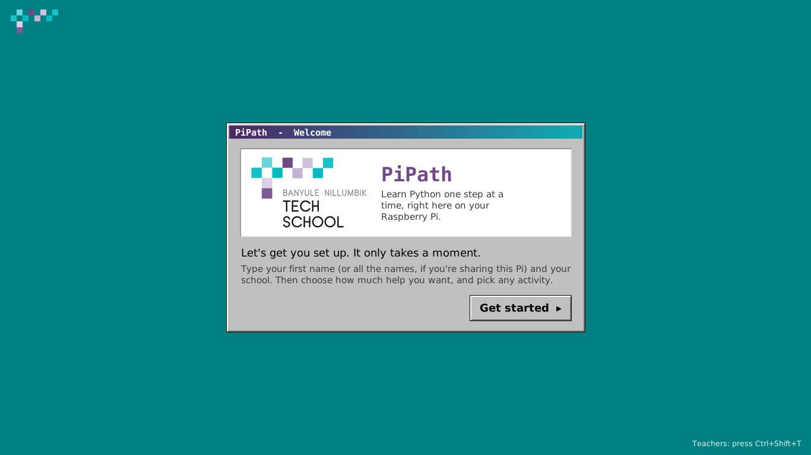
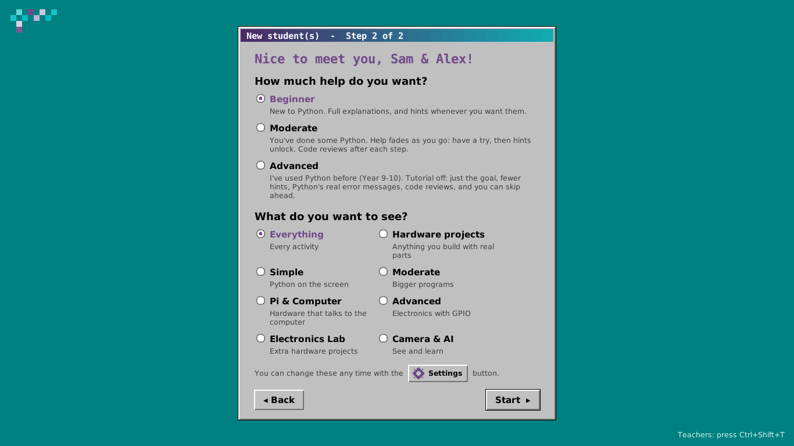
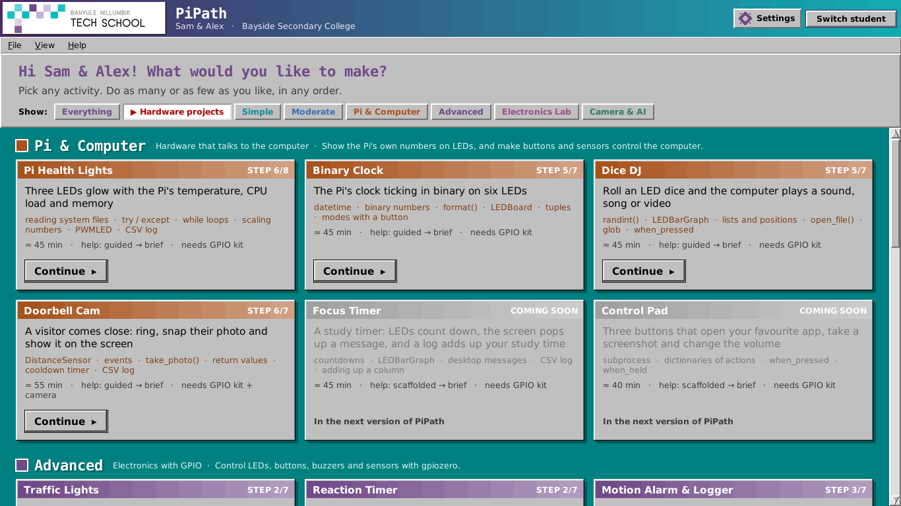
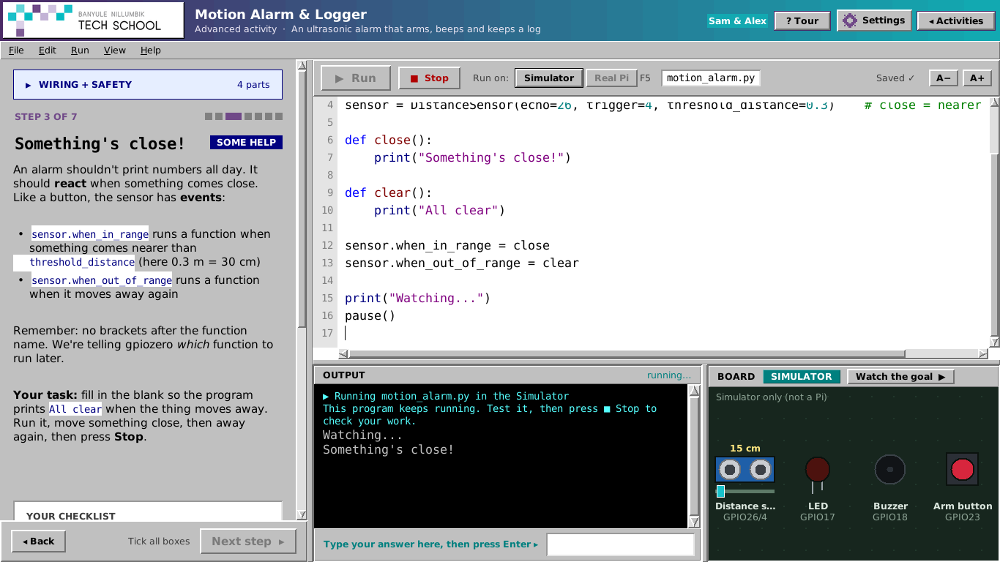
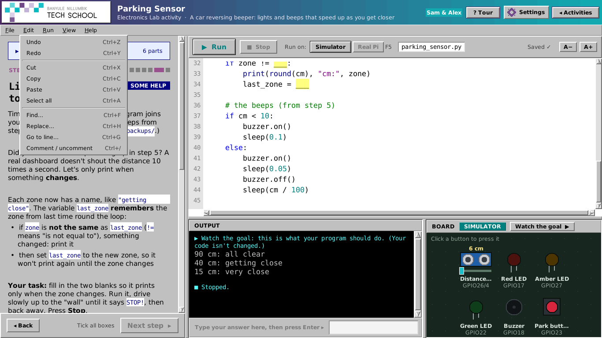
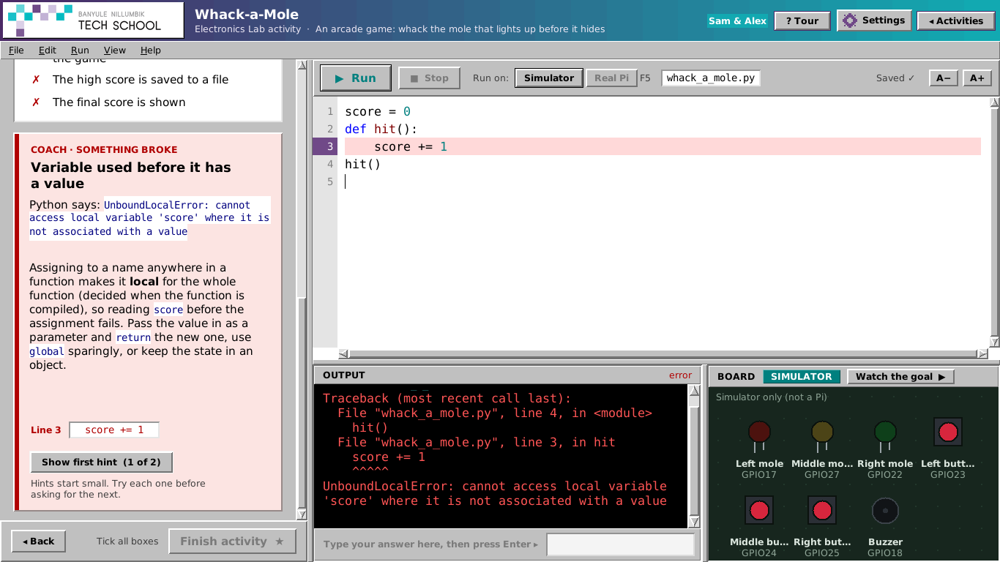
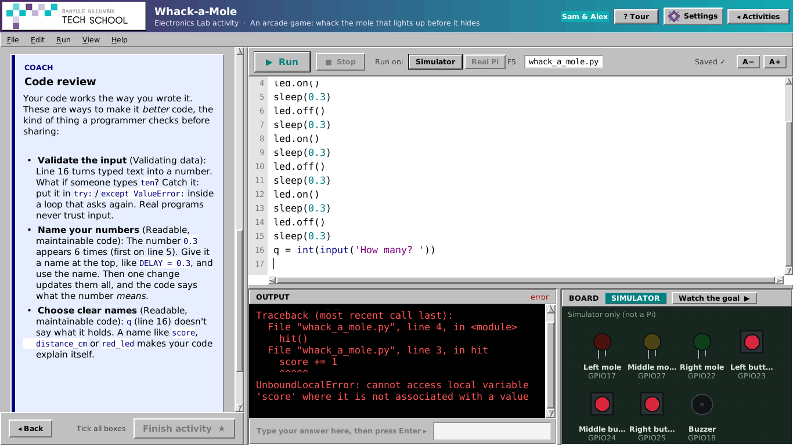
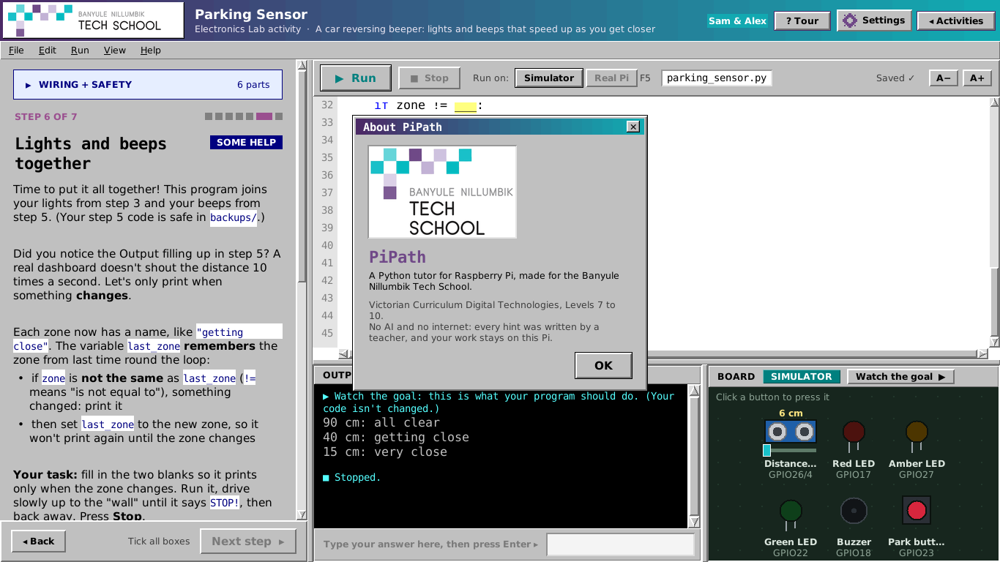

# PiPath

A Python coding tutor for Raspberry Pi with a classic Windows 95/98 look, in the colours of the
Banyule Nillumbik Tech School. Students log in with their **first name and school**
(up to four names on one profile when they share a Pi), then choose any activity: screen-only
Python, the Pi talking to its own computer, electronics with the GPIO pins, or the camera.
A built-in **Coach** explains errors in plain English and gives tiered hints from a
common-errors database. No AI service and no internet needed.

GPIO and camera activities work like MakeCode: students try their code on an on-screen
**Simulator** board first (and can **Watch the goal** to see what should happen), then
switch to **Real Pi** and run the same code on their breadboard. In Real Pi mode the board shows
**● LIVE** while the program drives the real pins.

## Screenshots

| | |
|---|---|
|  |  |
|  |  |
|  |  |
|  |  |

## Quick start (on the Pi)

```
git clone -b claude/gallant-ride-1ublon https://github.com/jackallen28/jackallen.git pipath
cd pipath
python3 main.py              # add --scale 1.25 for larger text
```

Install a menu entry and desktop icon:

```
./install.sh                 # or: ./install.sh --autostart   (opens PiPath at login)
```

Needs Raspberry Pi OS Desktop (Bookworm or newer, Python 3.11+). Tkinter, gpiozero, lgpio and
Picamera2 are already installed on the Desktop image. PiPath also runs on any Linux computer
with Python 3.11+ and Tkinter, in Simulator mode (`pip install gpiozero` for GPIO activities).

## How students use it

1. **Log in:** pick their name, or make a profile: first name (press **+ Add another student**
   for a pair or group, up to 4) and school.
2. **Set up** (step 2 of making a profile): choose **how much help they want** and **what they
   want to see** on the activity picker. Both can change any time with the **Settings** cog,
   which is on every screen (it also has the names, Simulator / Real Pi, the camera and the
   code text size). Help levels:
   - **Beginner:** full explanations, and hints whenever they want them
   - **Moderate:** help fades as they go (each activity's own plan: have a try, then hints unlock)
   - **Advanced** (Year 9-10, "tutorial off"): just the goal (the full explanation is one click
     away), fewer hints, no tour, and they can **skip** steps they already know
3. **Pick an activity.** Everything is open, and students do as many or as few as they like, in
   any order. The coloured tiers are a guide: *Simple*, *Moderate*, *Pi & Computer*, *Advanced*,
   *Electronics Lab*, *Camera & AI*. Cards show "Good to try first" tips.
4. **Work through the steps.** Each activity starts with one part (an LED, say), tests each new
   part on its own (the button), then joins them up, step by step, to the finished project.
   Every step has instructions, a checklist and the Coach. The first time, PiPath offers a
   30-second tour (**? Tour** shows it again).
5. **GPIO and camera activities** have:
   - **Run on: Simulator | Real Pi** next to the Run button (Real Pi only appears on a Pi)
   - the **board**, beside the Output. In the Simulator it *is* the hardware: click and hold
     buttons, drag the distance sensor's slider. In Real Pi mode it shows what the code is doing,
     live.
   - **Watch the goal ▶**: plays the finished step on the board (screen-only activities have it
     too, next to the Run button: it types the answers in, so students see a whole run)
   - a **Wiring + Safety** card with a pin map and **Check my wiring**
   - "I saw it happen" boxes in the checklist, ticked by the student after a run
   - for camera activities, a **camera panel**: click its title to switch
     **Simulated / USB / Ribbon** (remembered on that Pi)
6. **Free Build** is always open for their own projects. The board appears as soon as their
   code makes an LED or a Button.

## Coaching for Years 9-10

Students who have used Python before pick **Advanced** (at setup, or with the Settings cog):

- each step starts with the goal, and **Jump to the challenge** on an activity's first page skips the
  practice steps
- errors show Python's own message plus a technical explanation (scope, types, callbacks, zero-indexing...)
- after each step, and any time with **Run > Review my code**, the code review coach looks at *how*
  the code is written: repeated code, magic numbers, unclear names, input that isn't validated,
  `global`, bare `except:`, deep nesting, and functions without a test case
- every activity's first page lists its **Victorian Curriculum Digital Technologies (Levels 9-10)**
  links, and its finish page has three **Level up** challenges (classes, dictionaries, validation
  and `assert` test cases, CSV analysis, structured English...)

Moderate students get the code review and the deeper explanation too. Check the curriculum links
against the version of the Victorian Curriculum your school uses.

## Activities

| Tier | Activity | Students build | Kit |
|---|---|---|---|
| Simple | Hello, Pi! · Meet PiBot · Guess My Number | print, variables, input, if, loops | none |
| Moderate | Quiz Master · Turtle Art Studio · Tuckshop Till | *coming soon* | none |
| Pi & Computer | **Pi Health Lights** | read the Pi's temperature, CPU load and RAM (from the helper, then the file itself), a live monitor, text bar graphs, three LEDs that glow brighter as the numbers rise, warnings, a CSV log | 3 LEDs |
| Pi & Computer | **Binary Clock** | read the clock, binary with `format()`, a ticking clock on screen, the seconds live on six LEDs, a button for seconds / minutes / hours | 6 LEDs, button |
| Pi & Computer | **Dice DJ** | a button rolls an LED dice and the computer plays a sound for the number, then any song / video / picture from a folder; a surprise button opens a website | 6 LEDs, 2 buttons, speaker |
| Pi & Computer | **Doorbell Cam** | the distance sensor notices a visitor, a bell rings, the camera snaps them and the photo opens on the screen; cooldown + visitor log | HC-SR04, LED, buzzer, camera |
| Pi & Computer | Focus Timer · Control Pad | *coming soon* | |
| Advanced | **Traffic Lights** | one LED, the Australian sequence, `def cycle()` + loop, test the button, pedestrian crossing, beeper, countdown | 3 LEDs, button, buzzer |
| Advanced | **Reaction Timer** | the LED, random waits, test the button with a stopwatch, reaction game, false starts, 2-player race, high-score file | LED, 2 buttons |
| Advanced | **Motion Alarm & Logger** | test the light + buzzer, measure distance with the ultrasonic sensor, "something's close" events, the alarm, arm/disarm state, CSV log, cooldown + report | HC-SR04, LED, buzzer, button |
| Electronics Lab | Light Switch · RGB Mood Lamp · Simon Says · Bar Graph & Dice | events, PWM, colours, lists, games | see each Wiring card |
| Electronics Lab | **Parking Sensor** | a car reversing beeper: zones, beeps that speed up, a parking game | HC-SR04, 3 LEDs, buzzer, button |
| Electronics Lab | **Whack-a-Mole** | an arcade game with timeouts, a score that speeds up and a high-score file | 3 LEDs, 3 buttons, buzzer |
| Electronics Lab | **Morse Code Messenger** | dictionaries, sending with light and sound, timing a key, decoding, a quiz | LED, buzzer, button |
| Camera & AI | **Photo Booth** | photo, button photo, LED 3-2-1 countdown, all together, timestamped photos, photo strip | camera, 3 LEDs, button, buzzer |
| Camera & AI | **Teachable Machine** | images as numbers, training data, distance, a nearest-neighbour guess, lights for the answer, accuracy, bias | camera, 2 LEDs, button |

### Kit per Pi (covers every activity)

- Breadboard and male-to-female jumper wires
- LEDs: red, amber (yellow), green, plus 3 more for the Bar Graph; **330Ω resistor for every LED**
- 3 push buttons (4-leg tactile)
- 1 **active** buzzer (beeps when powered; a passive buzzer won't work with `Buzzer`)
- 1 **HC-SR04 ultrasonic distance sensor** (or similar: HC-SR04P, RCWL-1601) and a **1kΩ + 2kΩ**
  resistor for its ECHO pin (the two make the 5V echo a safe 3.3V; 3.3V sensors don't need them)
- Headphones or a small speaker (Dice DJ)
- Optional: 1 common-cathode RGB LED (Mood Lamp), 1 tilt switch (Dice)
- A camera: a **USB webcam** (any UVC webcam, e.g. DFRobot 720p wide-angle) or a
  **Raspberry Pi Camera Module** on the ribbon cable

### Standard pin plan (every activity uses it, so one build carries over)

| Part | GPIO | Physical pin |
|---|---|---|
| Red LED / LED 1 | 17 | 11 |
| Amber LED / LED 2 | 27 | 13 |
| Green LED / LED 3 | 22 | 15 |
| LED 4, 5, 6 | 5, 6, 13 | 29, 31, 33 |
| Button 1 / 2 / 3 | 23 / 24 / 25 | 16 / 18 / 22 |
| Buzzer (+) | 18 | 12 |
| Distance sensor TRIG | 4 | 7 (VCC → 5V pin 2, GND → pin 6) |
| Distance sensor ECHO | 26 | 37, through the 1kΩ / 2kΩ divider |

## Cameras

- **USB webcam:** plug it in. PiPath reads it directly (no extra software). Check it with
  `python3 pipath/student_lib/pipath_camera.py usb`
- **Ribbon camera:** (teacher) shut the Pi down, connect the ribbon (blue side towards the USB
  ports), turn on. Check it with `rpicam-hello --list-cameras`, then `python3 pipath/student_lib/pipath_camera.py ribbon`
- **Simulated:** no camera needed. The board makes pretend photos (a face, a ball, a box).

Students write the same code for all three: `from pipath_camera import Camera`,
`cam.take_photo("me.jpg")`, `cam.capture_grid(16, 16)`.

The **Pi & Computer** activities use a second helper, `from pipath_computer import ...`:
`cpu_temp()`, `cpu_load()`, `ram_used()` (read from `/sys` and `/proc`), and `open_file(name)` /
`open_website(url)` (opened with the desktop's normal app through `xdg-open`). **Watch the goal**
never opens anything; it shows what would open. `open_website` needs the internet, and the app
itself never goes online.

## GPIO safety (read before the GPIO activities)

The class kits use a **blue GPIO HAT** (breakout board). Students:

- **take the blue HAT off the GPIO pins before changing any wires**, and put it back on when done
- **never turn the Pi off** to change wires: they'd lose their progress (and an unsaved program)
- always put a 330Ω resistor in series with an LED
- never connect 5V to a GPIO pin: the distance sensor's ECHO goes through its two resistors
- don't power motors straight from GPIO pins
- ask the teacher to check the wiring before putting the HAT back on

The Wiring + Safety card in each activity repeats this, and "Check my wiring" failures say
"Take the blue HAT off, fix the wiring, put the HAT back on, then try again."

## For teachers

- **Teacher panel:** press **Ctrl+Shift+T** and enter the PIN (default `2468`, **change it** in
  `data/config.toml`). Teacher mode lets you skip steps for the session, and you can export
  everyone's progress (including each student's help level) to CSV.
- **Help levels** are the student's choice and can change any time. Independence stars still
  count the hints they open, at every level.
- **Student work** is saved in `~/PiPath/students/<name>/` (code, photos, logs). Updating PiPath
  never touches it.
- **Edit content** without coding:
  - `data/lessons/*.toml`: steps, starter code, checklists, hints, wiring, and `demo` (the model
    answer that **Watch the goal** plays, with `demo_events` for simulated button presses and
    `demo_input` for typed answers). Start each step's goal with `**Your task:**` or `**Goal:**`:
    Advanced students see just that part.
  - `data/errors.toml`: the Coach's explanations for common errors
  - `data/catalog.toml`: which activities appear, their tier, and "Good to try first" tips
  - `data/demo_files/`: sample files a lesson copies into the student's folder (`files = [...]`,
    e.g. the Dice DJ sounds; `python3 tools/make_party_sounds.py` remakes them)
  - `data/config.toml`: PIN, runaway-loop limits, star thresholds
- **Class set:** set up one Pi, then clone its SD card with *SD Card Copier*.
- **Speed on a Pi 3B:** `docs/perf.md` explains what keeps PiPath quick, and how to measure it
  on your Pis (`python3 tests/perf_probe.py`).
- **Testing on real hardware:** follow `docs/pi-test-checklist.md`.

## Developers

See `CLAUDE.md` for the architecture, data formats and what's next. Run the tests with:

```
python3 -m unittest discover -s tests
```

Every step's model answer (its `demo`) is run, in the Simulator for GPIO and camera steps,
with its button presses and typed answers, and must pass that step's own checklist. Screenshots of every main screen:
`xvfb-run -s "-screen 0 1366x768x24" python3 tests/gui_smoke.py shots/`
