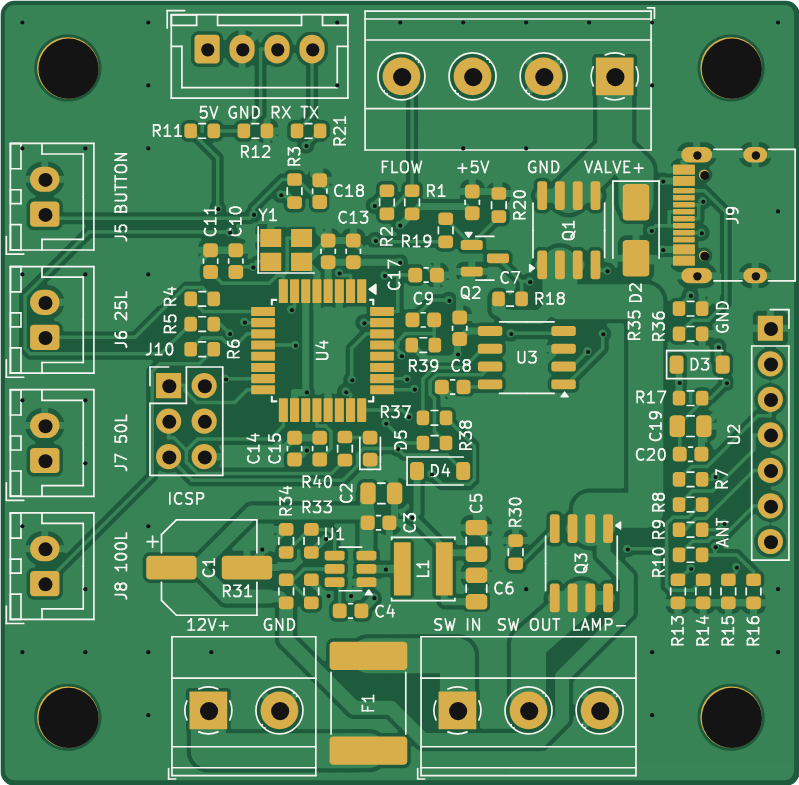

# Water Valve Controller: standalone ATmega328P board (rev A1, for review)

A second, separate version of the controller with the Arduino built in. There is no Arduino Nano
module: the board carries an ATmega328P with everything a Nano has around it, so it runs the same
sketch (`../WaterValveController.ino`) unchanged and uploads from the Arduino IDE over USB-C.
The Nano boards in [`../hardware`](../hardware) are not changed by this one.



| | Through-hole Nano board | Mixed Nano board | **ATmega board** |
|---|---|---|---|
| Size | 66 × 76 mm (5016 mm²) | 66 × 69.2 mm (4567 mm²) | **57 × 56 mm (3192 mm²)** |
| Smaller than the through-hole board | | 9% | **36%** |
| Microcontroller | Nano module on sockets | Nano module on sockets | ATmega328P-AU soldered on |
| 5 V supply | TO-220 regulator + heatsink area | TO-220 regulator + heatsink area | TPS54202H buck, 2 mm tall inductor |
| Fuse | ATO blade fuse holder | ATO blade fuse holder | 3 A resettable fuse (PTC) |
| Reverse supply | crowbar diode blows the fuse | crowbar diode blows the fuse | P-MOSFET simply stays off |
| Tallest parts | Nano on sockets, regulator | Nano on sockets, regulator | screw terminals, JST headers (about 10 mm), receiver module |
| Assembly | hand | JLCPCB SMD + through-hole | JLCPCB SMD + a few through-hole connectors |

`images/atmega-copper.png` shows both copper layers (front red, back blue).

## Why these parts (space first)

- **ATmega328P-AU (TQFP-32):** the Arduino Uno / Nano chip, so the pins, the core and the sketch
  stay the same. The QFN version is smaller still, but its pads are hidden under the chip; the board
  size is set by the connectors, not the chip, so the TQFP's visible pins are kept.
- **0603 resistors and capacitors:** the smallest size that is still easy to rework by hand; all
  are JLCPCB basic parts.
- **TPS54202H buck regulator:** about 90% efficient, so it needs no heatsink and the 18 × 19 mm
  heatsink area of the Nano boards is gone. It gives up to 2 A at 5 V for the ATmega, the receiver,
  the flow sensor and an ESP32 (about 0.6 A at most).
- **AO4407A valve switch (SOIC-8):** 14 mΩ, so 0.13 W at the 3 A fuse rating: no heatsink.
- **Resettable 3 A fuse (PTC, 2920 size):** 7.4 × 5 mm instead of the 20 × 7 mm blade holder, and
  nothing to replace after a fault: it resets once the fault is removed. If you would rather keep a
  replaceable blade fuse, say so: the Keystone holder fits at the bottom edge, adding about 4 mm to
  the board length.
- **Reverse-polarity MOSFET (AO4407A):** with the supply connected backwards it simply stays off;
  the Nano boards' crowbar diode blows the fuse instead.
- **Connectors unchanged:** the same 5.08 mm screw terminals and JST-XH headers in the same
  places (12 V in and the main switch on the bottom edge, the valve and flow sensor terminal on the
  top edge), so the wiring is the same as for the Nano boards.

## What makes it an Arduino

| Part | As on a Nano / Uno |
|------|--------------------|
| U4 ATmega328P-AU | the same microcontroller, at 16 MHz |
| Y1 16 MHz crystal + C10, C11 22 pF | the clock |
| C12–C15 100 nF | decoupling on both VCC pins, AVCC and AREF |
| R39 10 kΩ, D4 1N4148W | reset pull-up and clamp (as on the Uno) |
| J9 USB-C, U3 CH340N | USB to serial, as on most Nano boards; R35, R36 5.1 kΩ tell a USB-C charger or computer to supply 5 V |
| C9 100 nF | auto-reset: the IDE resets the ATmega to start the bootloader |
| R37, R38 1 kΩ | serial lines between the CH340N and D0 / D1 |
| D3 B5819W | lets the board run from USB alone for uploads, and stops 5 V flowing back into the computer |
| D5 + R40 | the "L" LED on D13 |
| J10 ICSP | standard 6-pin AVR ISP header, for burning the bootloader once (see Programming) |

Not included, to save space: a reset button (unplugging the power, or uploading, resets it) and a
power LED (the rocker switch's lamp shows the power).

## Pins (unchanged)

| Arduino pin | Use |
|-------------|-----|
| D0 / D1 | USB serial (Serial Monitor) |
| D2 | flow sensor, through R2 1 kΩ, with R1 10 kΩ pull-up and C17 10 nF |
| D4 | button J5 (R3 pull-up, C18 filter) |
| D5, D6, D7 | LEDs 25 / 50 / 100 L on J6–J8, through 330 Ω |
| D8 | valve: Q2 drives Q1's gate |
| D11 | data to the ESP32 (J4 pin 3), divided to 3.24 V by R11 / R12 |
| D12 | data from the ESP32 (J4 pin 4), through R21 1 kΩ |
| D13 | "L" LED |
| A0–A3 | receiver outputs D0–D3, through 1 kΩ, with 100 kΩ pull-downs |

The connectors are the same as on the Nano boards (see [the hardware README](../hardware/README.md#board-connectors)),
plus J9 (USB-C) and J10 (ICSP). The receiver socket U2 is on the right edge; its **GND** end is
nearest the USB socket and its **ANT** end towards the bottom.

## Programming

**Day to day:** once the chip has its bootloader, the board uploads over USB-C like any Arduino:
choose **Tools → Board → Arduino Uno** and the board's port. Windows 10/11, macOS and Linux have
the CH340 driver built in.

**Once, with an external programmer:** the ATmega328P from JLCPCB is blank (no bootloader, running
on its 1 MHz internal clock), so the Arduino bootloader goes in once through the ICSP header **J10**.
J10 has the standard 6-pin AVR ISP pinout, so any AVR ISP programmer plugs straight on:

```
            J10 (looking at the top of the board)
   pin 1  MISO (D12)   ■ ●  pin 2  +5V
   pin 3  SCK  (D13)   ● ●  pin 4  MOSI (D11)
   pin 5  RESET        ● ●  pin 6  GND
   (pin 1 is the square pad)
```

The extra parts on these lines are what an Arduino Uno has (10 kΩ pull-up and 100 nF auto-reset on
RESET, the D13 LED on SCK) plus the ESP divider on MOSI, all light enough for any programmer. J10 is
left empty: solder in a 2 × 3 pin header (2.54 mm), or cut one from a 2 × 40 strip. There is room
around it for a 6-pin ribbon-cable plug.

### Recommended: Pololu USB AVR Programmer v2.1

About A$30 (Core Electronics stocks it as POLOLU-3172). It comes with the 6-pin cable, its default
ISP speed (114 kHz) suits a blank 1 MHz chip, it adapts to 5 V by itself, and the Arduino IDE
supports it.

1. Unplug the ESP32 from J4 (it shares D11 and D12 with the ICSP pins).
2. Power the board from its own USB-C (any USB charger or computer port). The programmer does not
   supply power by default, and the board has more capacitance on 5 V than its power output can start.
3. Plug the 6-pin cable onto J10 with the cable's pin 1 (red stripe / triangle on the plug) on the
   square pad, and the programmer into the computer.
4. In the Arduino IDE: **Tools → Board → Arduino Uno**, **Tools → Programmer → Atmel STK500
   development board**, **Tools → Port →** the programmer's *programming* port (it shows two ports),
   then **Tools → Burn Bootloader**. This sets the fuses (16 MHz crystal, brown-out reset at 2.7 V)
   and writes the Uno bootloader. It takes about a minute.
5. Unplug the programmer and upload the sketch over the board's USB-C as an Arduino Uno.

### Free: your Arduino Nano as the programmer

1. Upload **File → Examples → 11.ArduinoISP → ArduinoISP** to the Nano.
2. Put a 10 µF capacitor between the Nano's RESET and GND (+ leg to RESET), so the IDE does not
   reset the Nano while it is programming.
3. Unplug the ESP32 from J4, then wire the Nano to J10: D12 → pin 1, D13 → pin 3, D11 → pin 4,
   D10 → pin 5, GND → pin 6, and 5V → pin 2 (or leave 5V off and power the board from its USB-C).
4. In the IDE: **Tools → Board → Arduino Uno**, **Tools → Programmer → Arduino as ISP**, the Nano's
   port, then **Tools → Burn Bootloader**.

### Not recommended for this: cheap USBasp clones

They work, but they come with a 10-pin cable (you need a 10-to-6-pin adapter), need a driver
installed with Zadig on Windows, and many still have old firmware that is too fast for a blank chip
unless you fit their "slow SCK" jumper.

The board runs from USB alone for programming and testing; the valve only switches with 12 V
connected.

## Current and heat

The valve current path is laid as fixed 2.5 mm tracks on the top copper (about 4.6 A for a 10 °C
rise with 1 oz copper): 12 V in → fuse → main switch → reverse-polarity MOSFET → up the right
side → valve switch Q1 → J3. It returns through the ground copper poured over both layers and
stitched together. Q1 and Q3 dissipate about 0.13 W each at 3 A; the regulator about 0.3 W at
0.6 A.

## Ordering

The [`JLCPCB/`](JLCPCB/) folder has the gerber zip, the BOM (CSV and `.xlsx` like JLCPCB's sample
BOM) and the CPL file, in the format of JLCPCB's KiCad guide, plus a README with the upload steps.
Every part also has an **LCSC Part #** field, so the KiCad Fabrication Toolkit plugin can make the
same files after you change the design. `WaterValveController-ATmega-KiCad.zip` is the KiCad project
to open and edit (KiCad 7 or later). `WaterValveController-ATmega-assembly.pdf` shows every part's
reference on the board outline (two small parts, R32 and C16, have no room for a silkscreen label).

## Open points to confirm

1. **Fuse:** resettable 3 A PTC (as drawn) or a replaceable blade fuse holder.
2. **Reverse-polarity protection:** MOSFET (as drawn) or the Nano boards' crowbar diode.
3. **Reset button and power LED:** left out to save space; either can be added.
4. **Part numbers:** the passives, crystal, diodes and LED are JLCPCB basic parts that JLCPCB's BOM
   step should confirm (they are marked in `tools/gen_atmega.py`).
5. **Size:** the four M4 corner holes, the 5.08 mm terminals and the four panel connectors down the
   left edge set the size. M3 holes, 3.5 mm terminals or one combined panel connector would take
   it to about 50 × 50 mm.

## Regenerating

The schematic, board and outputs are made by `tools/gen_atmega.py`, which uses the Nano boards'
tools in `../hardware/tools` (KiCad 7, Java 17+ and Freerouting 1.9):

```sh
cd hardware-atmega
python3 tools/gen_atmega.py sch                                  # schematic, checks every net
python3 tools/gen_atmega.py pcb --jar freerouting-1.9.0.jar      # place, route, pour, DRC, gerbers
python3 tools/gen_atmega.py outputs                              # PDF/SVG, BOMs, JLCPCB files, images, zip
```

The circuit is listed part by part in `tools/gen_atmega.py`; placement and the fixed power tracks
are in `tools/atmega_board.py`.
