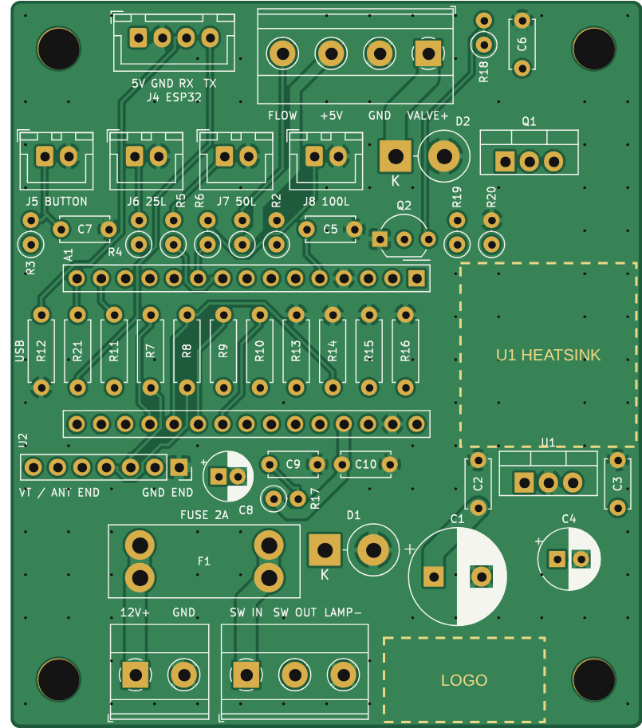
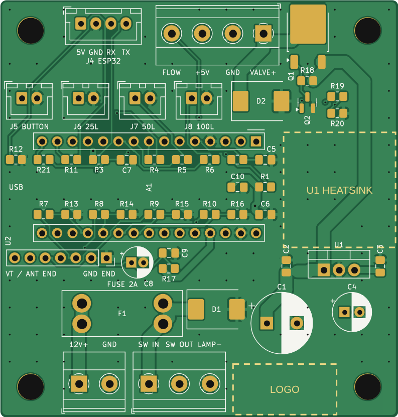

# Water Valve Controller: schematic and PCBs

A 2-layer carrier board for the Arduino Nano. It brings every connection out to screw terminals or
JST-XH connectors and adds the valve switch, fuse, filtering and protection parts. The 433 MHz
receiver module plugs straight into the board.

The same circuit comes as two boards, so you can compare them:

| | Through-hole (THT) | Mixed SMD + THT |
|---|---|---|
| Folder | this folder | [`smd/`](smd/) |
| Size | **66 × 76 mm** (5016 mm²) | **66 × 69.2 mm** (4567 mm², 9% smaller) |
| Small parts | 1/4 W resistors, ceramic discs, TO-92, DO-201AD | 0805 (hand-solder pads), SOT-23, DPAK, SMC |
| Valve MOSFET Q1 | IRF9540N (TO-220) | IRFR5305 (DPAK) |
| Soldering | everything with an ordinary iron | 0805 parts need a fine tip and tweezers |

 

The SMD board is only a little smaller because the parts that set the size are the same on both: the
screw terminals, the blade fuse holder, the Nano, the receiver, the JST connectors, the regulator and
its heatsink space, and the electrolytic capacitors (radial cans are smaller than SMD ones, so both
boards use them). On the through-hole board most small parts already lie flat under the Nano.

`images/*-copper.png` show both copper layers (front red, back blue) if you want to check the routing.

## Files

| File | What it is |
|------|------------|
| `WaterValveController-schematic.pdf` / `.svg` | The schematic (the same for both boards) |
| `WaterValveController.kicad_pro`, `.kicad_sch`, `.kicad_pcb` | KiCad 7 project, through-hole board |
| `smd/WaterValveController-SMD.*` | KiCad 7 project, mixed SMD + THT board |
| `*-gerbers.zip` | Gerber and drill files: upload this to the board maker |
| `*-BOM.csv` | Parts list for that board |
| `*-positions.csv` | Part positions, for an assembly service |
| `*-PCB-top.pdf` | Top copper and silkscreen, printable at 1:1 to check part fits |
| `*-KiCad.zip` | The whole KiCad project in one zip |
| `WaterValve.pretty/` | Two board footprints: the socketed Nano and the Keystone 3557-2 fuse holder |
| `tools/` | Scripts that generate all of the above (see the end of this file) |

## Board connectors

All terminals are 5.08 mm screw terminals; J4 to J8 are JST-XH (2.5 mm) headers. Pin 1 of every
connector is the square pad, and the pin names are on the silkscreen.

| Ref | Where | Connector | Pins |
|-----|-------|-----------|------|
| J1 | bottom edge | **12 V IN**, 2-way | 1 = +12 V, 2 = GND |
| J2 | bottom edge | **MAIN SWITCH**, 3-way | 1 = SW IN (fused 12 V to the switch), 2 = SW OUT (switched 12 V back), 3 = LAMP− (GND for the switch lamp) |
| J3 | top edge | **VALVE / FLOW**, 4-way | 1 = VALVE+ (switched 12 V), 2 = GND (valve − and sensor black), 3 = +5V (sensor red), 4 = FLOW (sensor yellow) |
| J4 | top edge | **ESP32**, JST-XH 4-pin | 1 = 5V, 2 = GND, 3 = RX (to ESP GPIO20, 3.3 V), 4 = TX (from ESP GPIO21) |
| J5 | top | **BUTTON**, JST-XH 2-pin | 1 = button, 2 = GND |
| J6–J8 | top | **LED 25L / 50L / 100L**, JST-XH 2-pin | 1 = LED + (anode), 2 = LED − (cathode). The 330 Ω resistors are on the board |
| U2 | left, below the Nano | RX480E-4 receiver, 7-pin socket | 1 GND, 2 +V, 3–6 D0–D3, 7 VT (unused) |

**Main switch.** An illuminated rocker switch has three terminals: power in, load out and lamp. Wire
power in to J2 pin 1, load out to J2 pin 2 and the lamp terminal to J2 pin 3. The 12 V goes through
the fuse before it reaches the switch. Without a switch, link J2 pins 1 and 2.

**Panel LEDs and button.** Use plain LEDs (not "12 V" LEDs with a built-in resistor) and a normally
open momentary button, each on a 2-pin JST-XH lead.

**Receiver orientation.** U2 stands upright in a 7-pin socket. GND is the pin at the module's
learn-button end and VT is at its antenna end. The silkscreen marks **GND END** and **VT / ANT END**:
plugged in backwards, the module puts 5 V onto an output.

**Nano orientation.** The Nano sits across the board on two 15-pin female headers with its USB
connector at the left edge (marked **USB**). Pin 1 (D1/TX) is the square pad at the right.

The sketch uses the same pins as the schematic. With this board, keep `VALVE_DRIVE_ACTIVE_LOW = false`
and `REMOTE_ACTIVE_LOW = false` (the defaults).

## Valve driver

The valve is switched on the board, so no relay module is needed. Q1, a P-channel MOSFET, switches
the 12 V to J3 pin 1 (high-side switching, so the valve's other wire goes to GND).

- **D8 HIGH:** Q2 pulls Q1's gate low and the valve gets 12 V.
- **D8 LOW, or the Nano unplugged or starting up:** R20 holds Q2 off and R18 holds Q1 off, so the valve
  stays unpowered.
- **D2** is the flyback diode for the switch-off spike. It sits right at J3. An extra diode on the
  valve terminals does no harm.

At 1 A of valve current Q1 dissipates about 0.12 W (IRF9540N) or 0.07 W (IRFR5305), so it needs no
heatsink. Either part handles valves up to about 2 A without one.

## Power, fuse and switch

J1 → F1 (blade fuse) → J2 pin 1 → main switch → J2 pin 2 → +12 V for the board and the valve.

- **F1** is a Keystone 3557-2 holder for standard ATO/ATC blade fuses (4 legs on a 13.5 × 3.4 mm
  pattern). Use a **2 A** fuse; 3 A if your valve draws more than 1 A.
- **D1** crowbar: if the supply is connected backwards, D1 conducts and blows the fuse. It sits before
  the switch, so this works with the switch off too.
- **U1:** a TO-220-footprint 5 V regulator. The **R-78E5.0-1.0** switching regulator is recommended:
  it is about 90% efficient and runs cool. An **L7805** also fits, but dropping 12 V to 5 V at the
  ESP32's 0.5 A peaks makes about 3.5 W of heat, so it needs a heatsink.

## Current, heat and weight

- **Copper.** The board uses standard 1 oz (35 µm) copper. The 12 V and valve tracks are 2.0 mm wide
  (about 4 A for a 10 °C rise, IPC-2221), twice the 2 A fuse rating. +5 V and GND tracks are 1.0 mm
  (about 2.4 A), and GND is also poured over both layers and stitched together with vias, so the valve
  current has a wide return path. 2 oz copper isn't needed.
- **Heatsink space.** The area marked **U1 HEATSINK** on the board (about 18 × 19 mm, above the
  regulator's tab) is kept free of parts, so a TO-220 heatsink fits there. The electrolytic capacitors
  are kept away from it.
- **Weight.** The screw terminals and the 470 µF capacitor sit next to the M4 mounting holes, where
  the board is held. Everything under the Nano is low (flat resistors or SMD parts).
- **Spacing.** Parts have at least 0.4 mm between their courtyards (which already include a margin
  round each part), and the SMD parts use the larger "hand-solder" pads.

## Assembly order

1. The parts that sit under the Nano: on the THT board, the flat resistors R7–R16 and R21; on the SMD
   board, all the 0805 parts inside the Nano's outline. Solder them before the Nano's headers.
2. The rest of the small parts, then the taller ones: Q1, Q2, D1, D2, U1, capacitors, the fuse holder,
   the JST headers and the screw terminals.
3. The two 15-pin female headers for the Nano and the 7-pin socket for the receiver. Plug the Nano in
   with its USB connector at the **USB** mark, and the receiver with its antenna end at **VT / ANT END**.
4. Before plugging in the Nano and receiver, power the board from 12 V and check for 5 V between
   J3 pins 3 and 2.

## Ordering the boards

Upload `WaterValveController-gerbers.zip` (or `smd/WaterValveController-SMD-gerbers.zip`) to any
low-cost PCB maker (JLCPCB, PCBWay, OSH Park …) with these options: **2 layers, 1.6 mm thick, 1 oz
copper, HASL or ENIG**. The design rules suit all of them: 0.25 mm minimum track, 0.2 mm clearance,
0.6 / 0.3 mm vias. For an assembly service, also send the BOM and the positions file.

The clear **LOGO / TEXT AREA** (about 17 × 8 mm) has no tracks or vias, only the flat ground pour,
so a silkscreen logo or text printed there will be crisp. In KiCad, place your logo there on the
F.Silkscreen layer. The board's name is on the back silkscreen.

## How the board reduces interference

1. **Valve switch-off spike:** D2 flyback diode right at J3.
2. **Valve current:** 2 mm tracks, and GND poured on both layers, so the valve current doesn't disturb
   the Nano's ground.
3. **Decoupling:** C1 470 µF + C2 100 nF on 12 V, C3 100 nF + C4 100 µF at U1, C10 at the Nano's 5V
   pin, C6 at J3 for the flow sensor.
4. **Flow input filter:** R1 10 kΩ pull-up gives clean edges. R2 1 kΩ + C5 10 nF filter out short
   spikes (10 µs time constant, far faster than the sensor's ~108 Hz maximum), and R2 also protects
   the pin. The firmware ignores pulses less than 2 ms apart.
5. **Button and remote inputs:** the button has a 10 kΩ pull-up and a 100 nF filter. Each receiver
   output has a 1 kΩ series resistor (R7–R10) and a 100 kΩ pull-down (R13–R16), so the inputs never
   float. The receiver's supply is filtered by R17 10 Ω + C8 47 µF + C9 100 nF. The firmware
   debounces both.
6. **Supply protection:** fuse F1 and crowbar D1, ahead of the main switch.
7. **ESP link:** R11 1.8 kΩ / R12 3.3 kΩ drop the Nano's 5 V data to 3.24 V for the ESP's 3.3 V
   input. R21 1 kΩ protects D12 on the return line.
8. **Layout:** the receiver's antenna end is at the left edge, away from the valve driver at the top
   right and the regulator at the right. The 12 V input is on the opposite edge from the valve and
   sensor terminal.
9. **Cables:** twist the flow sensor's signal wire with its GND wire and keep it away from the valve
   and 12 V wires. For a long sensor run, use shielded cable with the shield connected to GND at the
   controller end only.

## Regenerating the files

Everything is generated by scripts, so the wiring is checked automatically and the boards can be
re-routed after a change. You need KiCad 7 (`kicad-cli` and its Python module), Java 17+ and
[Freerouting](https://github.com/freerouting/freerouting) 1.9 (2.x also works). On a computer
without a screen, Freerouting 1.9 runs under `xvfb-run`.

```sh
cd hardware
python3 tools/gen_schematic.py .                 # through-hole project
python3 tools/gen_schematic.py smd smd           # mixed SMD + THT project
kicad-cli sch export netlist --format kicadxml -o /tmp/net.xml WaterValveController.kicad_sch
python3 tools/check_netlist.py /tmp/net.xml      # compares every net against the intended design
python3 tools/gen_pcb.py tht --jar freerouting-1.9.0.jar   # place, autoroute, pour, DRC, gerbers
python3 tools/gen_pcb.py smd --jar freerouting-1.9.0.jar
python3 tools/make_outputs.py                    # schematic PDF/SVG, BOM, images, zip
python3 tools/make_outputs.py smd
```

Part positions, the logo and heatsink areas and the silkscreen labels are in `tools/pcb_layout.py`.
`gen_pcb.py --place-only` stops before routing, for checking a new layout.
