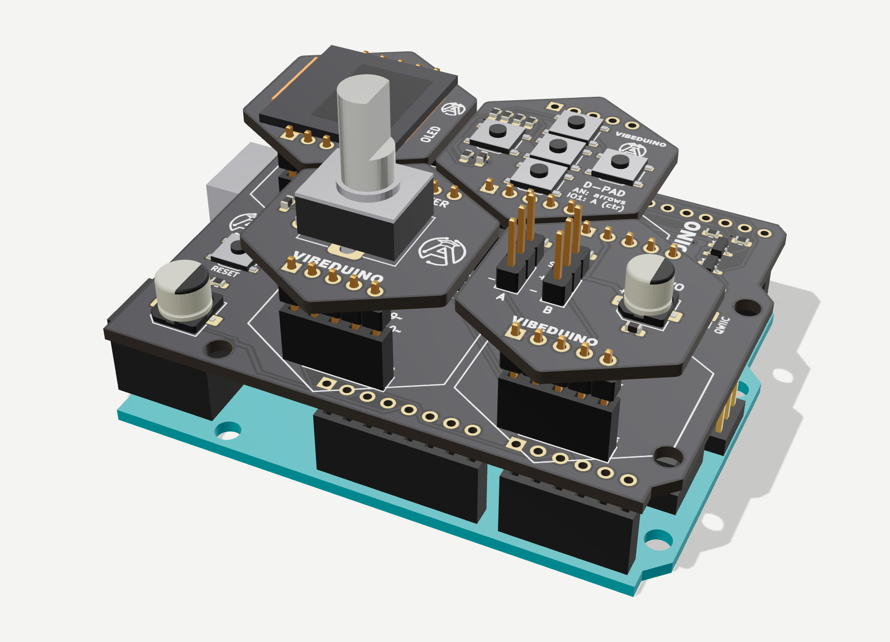
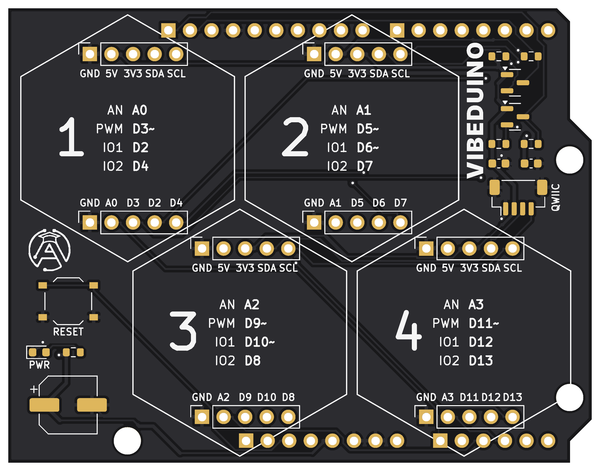
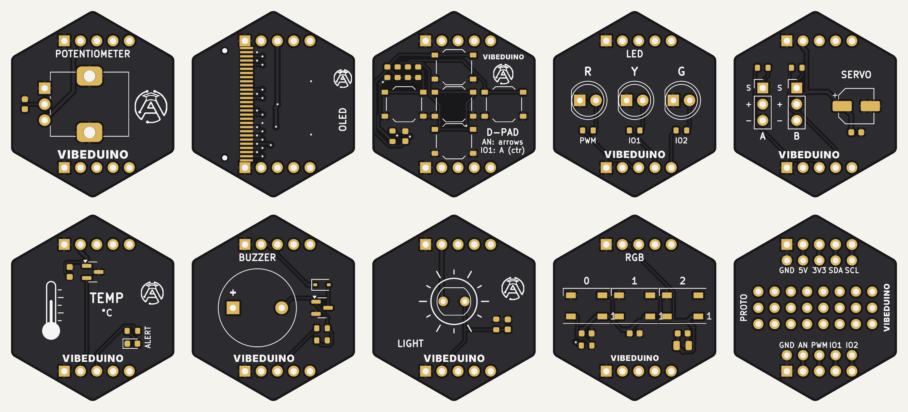

# VIBEDUINO — hex modules for Arduino Uno

**Allentronics Education Services · [www.allentronics.com.au](https://www.allentronics.com.au)**

VIBEDUINO is a snap-together electronics kit. One **shield** sits on an Arduino Uno R3 and has
four **slots**. Every **module** is the same 1-inch hexagon with the same 10-pin keyed bus, so
any module fits in any slot, and four of them tile together on the shield like a honeycomb.
Students pick the modules for a project, plug them in, and program the Uno over USB.



> **Status — rev A, ready for a prototype order.** Every board is placed, fully routed, has
> copper pours and has passed KiCad DRC. Each board also has a schematic (checked pin-for-pin
> against its PCB), a BOM with manufacturer and LCSC part numbers, JLCPCB-ready Gerbers, drill
> and pick-and-place files, and a STEP model. The ten modules also come as one
> **[production panel](panel/README.md)**. See [BOM.md](BOM.md) and sections 5–6.

| Board | Previews |
|---|---|
| Shield | [top](previews/vibeduino-shield-top.png) · [bottom](previews/vibeduino-shield-bottom.png) · [routing](previews/vibeduino-shield-layout.png) · [schematic](previews/vibeduino-shield-schematic.png) |
| All modules | [top views](previews/modules-top.png) · [bottom views](previews/modules-bottom.png) · [routing](previews/modules-layout.png) |
| Module schematics | [POT](previews/vibeduino-pot-schematic.png) · [OLED](previews/vibeduino-oled-schematic.png) · [D-PAD](previews/vibeduino-dpad-schematic.png) · [LED](previews/vibeduino-led-schematic.png) · [SERVO](previews/vibeduino-servo-schematic.png) · [TEMP](previews/vibeduino-temp-schematic.png) · [BUZZER](previews/vibeduino-buzzer-schematic.png) · [LIGHT](previews/vibeduino-light-schematic.png) · [RGB](previews/vibeduino-rgb-schematic.png) · [PROTO](previews/vibeduino-proto-schematic.png) — all 11 in one PDF: [vibeduino-schematics.pdf](schematics/vibeduino-schematics.pdf) |
| 3D renders | [shield](previews/3d/vibeduino-shield-3d.png) · [all modules](previews/3d/modules-3d.png) · [modules, underside](previews/3d/modules-3d-bottom.png) · [stack: OLED, D-PAD, POT, SERVO](previews/3d/vibeduino-assembly-3d.png) · [stack: LED, RGB, TEMP, BUZZER](previews/3d/vibeduino-assembly-2-3d.png) |
| Fit check (2D) | [OLED + D-PAD + POT + SERVO](previews/vibeduino-assembly.png) · [LED + RGB + TEMP + BUZZER](previews/vibeduino-assembly-2.png) (bare PCBs; panel, knob and caps not drawn) |
| Production panel | [10 modules, top](panel/previews/vibeduino-modules-panel-top.png) · [bottom](panel/previews/vibeduino-modules-panel-bottom.png) · [ordering guide](panel/README.md) |

---

## 1. System specification

### Hex module

| Parameter | Value |
|---|---|
| Shape | Regular hexagon, pointy end towards the Uno's digital header |
| Size | **25.40 mm across flats (1.000")**, 29.33 mm corner to corner, 1.0 mm corner fillets |
| PCB | 2-layer FR4, 1.6 mm, 1 oz, GND pour on both sides |
| Gap between modules on the shield | 1.0 mm (centre pitch 26.4 mm, row pitch 22.86 mm) |
| Mounting | Male headers on the module underside → female sockets on the shield. Module PCB ends up ~11 mm above the shield |
| Branding | Top: VIBEDUINO wordmark, module name, Allentronics mark. Underside: Allentronics logo lock-up, website, bus pin labels |

### The VIBEDUINO bus — identical on every module

Two 1×5, 2.54 mm headers. J1 sits near the top vertex and J2 near the bottom vertex. Pin 1 is
on the left, viewed from the top.

| Pin | J1 (power + I²C, shared) | J2 (signals, per slot) |
|---|---|---|
| 1 | GND | GND |
| 2 | +5 V | **AN** — analog input (also usable as digital) |
| 3 | +3.3 V | **PWM** — PWM-capable digital pin |
| 4 | SDA (3.3 V logic) | **IO1** — digital pin |
| 5 | SCL (3.3 V logic) | **IO2** — digital pin |

**Keyed: it cannot be plugged in backwards.** Both header rows are shifted 0.635 mm (¼ pitch)
off the hex centre. If a module is turned 180°, every pin lands 1.27 mm (½ pitch) away from a
socket contact, so it physically will not go in. Without this, a reversed module would put
5 V onto signal pins. Pin 1 of both rows is GND.

### Slot map (shield → Arduino pins)

Slots are numbered left-to-right, top row first, with the USB jack on the left.

| Slot | AN | PWM | IO1 | IO2 |
|---|---|---|---|---|
| 1 (top-left) | A0 | D3~ | D2 | D4 |
| 2 (top-right) | A1 | D5~ | D6~ | D7 |
| 3 (bottom-left) | A2 | D9~ | D10~ | D8 |
| 4 (bottom-right) | A3 | D11~ | D12 | D13 |

* **All four slots can be programmed and used at the same time.** No two slots share a signal
  pin. Only the I²C bus and the power rails are shared.
* **D0/D1 (USB serial) are never used**, so sketches upload over USB with all four modules
  fitted. The shield has its own RESET button because it covers the Uno's.
* I²C comes from the R3 SDA/SCL pins. It runs through a BSS138 level shifter, so the module bus
  is **3.3 V I²C** (4.7 k pull-ups to 3V3, 10 k to 5 V on the Uno side). A Qwiic/STEMMA-QT port
  shares the same bus.
* Slot 4 carries the hardware SPI pins (D11 MOSI, D12 MISO, D13 SCK), with A3 free for chip
  select, ready for future SPI modules. D13 also drives the Uno's "L" LED.
* Arduino timer caveats to teach or design around:
  * The `Servo` library disables PWM on D9/D10 (slot 3's PWM/IO1).
  * `tone()` uses Timer2, which affects PWM on D3 and D11 (slots 1 and 4).

### Fit check

`generator/vibeduino/assembly.py` checks the geometry on every build:

* adjacent modules: 1.00 mm board gap; header and socket bodies at least 0.72 mm apart
* all four modules lie inside the Uno R3 outline
* no through-hole lead sits above the Uno's USB-B jack, DC jack or ICSP header (the shield rests ~11 mm up, on the USB jack)

## 2. Shield — `kicad/shield/vibeduino-shield.kicad_pcb`



* Arduino Uno R3 outline. Headers are placed from the official Uno dimensions.
  KiCad's stock `Arduino_UNO_R3` footprint is a mirrored bottom view, so it is deliberately not
  used.
* 4 slots × 2 female 1×5 sockets.
  * The silkscreen shows each slot's hex outline, number and Arduino pin map.
  * Every socket pin is labelled with its Arduino pin name.
* BSS138 I²C level shifter, Qwiic connector (top entry), RESET button, power LED, 100 µF bulk cap.
* 3 of the Uno's 4 mounting holes. The one at (15.24, 50.8) mm sits under slot 1's socket.
* Underside: full Allentronics logo, VIBEDUINO SHIELD title, slot map table, website.
* Fab layer marks the Uno's USB/DC/ICSP keep-out zones. Trim socket leads to ≤ 1.5 mm.

## 3. Modules — `kicad/modules/<name>/vibeduino-<name>.kicad_pcb`



| Module | What it does | Bus signals used | Key parts |
|---|---|---|---|
| **POT** | Rotary knob | AN = 0–5 V | Alps RK09K 10 k, vertical shaft |
| **OLED** | 64×48 OLED display | SDA/SCL (I²C 0x3C, jumper → 0x3D), 3V3 | 0.66" SSD1306 COG panel, 28-pin FPC (mounted portrait) |
| **D-PAD** | Up/Down/Left/Right + "A" | AN = resistor ladder (UP≈0, RIGHT≈93, DOWN≈254, LEFT≈512, none 1023), IO1 = A button (LOW when pressed) | 5× TS-1187A tactile |
| **LED** | Traffic light | PWM = red, IO1 = yellow, IO2 = green (HIGH = on) | 3× 5 mm diffused LEDs, 470 Ω |
| **SERVO** | Two hobby servos | PWM = servo A, IO1 = servo B | 2× 3-pin servo headers (S + −), 220 Ω series, 100 µF |
| **TEMP** | Temperature + alert LED | AN = MCP9700A (°C = (mV − 500) / 10, same maths as TMP36), PWM = red LED | MCP9700A SOT-23 |
| **BUZZER** | Sounds and melodies | PWM = `tone()` | 12 mm passive magnetic buzzer, MMBT3904 driver, flyback diode |
| **LIGHT** | Light level | AN (brighter = higher) | 5 mm LDR + 10 k divider |
| **RGB** | 3 addressable RGB LEDs | PWM = NeoPixel data | 3× WS2812B-5050 |
| **PROTO** | Build your own | every bus pin on a labelled pad + 2.54 mm grid | — |

Every module's parts list (refs, values, footprints, side) is in
`kicad/modules/<name>/module.json`. This is the starting point for the BOM.

### Quick code reference (slot 1 shown)

```cpp
const int AN = A0, PWM = 3, IO1 = 2, IO2 = 4;   // see slot map for slots 2-4
analogRead(AN);                 // POT, LIGHT, TEMP, D-PAD ladder
analogWrite(PWM, 128);          // LED red half brightness
tone(PWM, 440);                 // BUZZER
pinMode(IO1, INPUT_PULLUP);     // D-PAD "A" button (LOW = pressed)
// OLED: U8g2 "U8G2_SSD1306_64X48_ER_F_HW_I2C" or SparkFun Qwiic OLED library, address 0x3C
// RGB:  Adafruit_NeoPixel strip(3, PWM, NEO_GRB + NEO_KHZ800);
```

## 4. Verification (rev A)

| Board | DRC errors | Unconnected | Notes |
|---|---|---|---|
| `vibeduino-shield` | 0 | 0 | 28 footprints, 438 track segments, 14 vias; 31 cosmetic warnings (silkscreen clipped by pads / overlapping artwork) |
| `vibeduino-pot` | 0 | 0 | 4 footprints, 22 track segments, 0 vias |
| `vibeduino-oled` | 0 | 0 | 14 footprints, 151 track segments, 23 vias; 3 cosmetic warnings (silk clipped by pads; 1 redundant fan-out via on a fully connected net) |
| `vibeduino-dpad` | 0 | 0 | 13 footprints, 110 track segments, 4 vias |
| `vibeduino-led` | 0 | 0 | 8 footprints, 31 track segments, 0 vias |
| `vibeduino-servo` | 0 | 0 | 8 footprints, 49 track segments, 0 vias |
| `vibeduino-temp` | 0 | 0 | 6 footprints, 36 track segments, 0 vias |
| `vibeduino-buzzer` | 0 | 0 | 7 footprints, 36 track segments, 0 vias; 1 cosmetic warning (overlapping silkscreen) |
| `vibeduino-light` | 0 | 0 | 5 footprints, 17 track segments, 0 vias |
| `vibeduino-rgb` | 0 | 0 | 10 footprints, 84 track segments, 1 via; 2 cosmetic warnings (silkscreen clipped by pads) |
| `vibeduino-proto` | 0 | 0 | 4 footprints, 13 track segments, 0 vias |

Design rules are JLCPCB-friendly:
* tracks ≥ 0.15 mm, 0.2 mm signal tracks, 0.15 mm clearance;
* 0.6/0.3 mm vias, 0.3 mm copper-to-edge;
* 5 V, 3V3 and GND are widened to 0.4 mm wherever clearance allows.

The remaining DRC *warnings* are cosmetic: silkscreen clipped by pads or overlapping
neighbouring artwork. The full report sits next to each board after a build
(`*-drc.rpt`, git-ignored).

Every schematic is exported back to a netlist with `kicad-cli` and compared pin-for-pin with
its PCB. All 11 match exactly. The release script also re-runs DRC after adding the BOM fields
and stops if anything changed.

## 5. Schematics, BOM and fab files

| What | Where |
|---|---|
| KiCad projects (PCB + schematic, open the `.kicad_pro`) | `kicad/shield/`, `kicad/modules/<name>/` |
| Custom symbols and footprints (OLED panel, PROTO breakout, NPTH holes) | `kicad/lib/` (each project's `sym-lib-table` / `fp-lib-table` point here) |
| All schematics as one PDF | `schematics/vibeduino-schematics.pdf` |
| Bill of materials (kit totals, per-board counts, ordering notes) | [`BOM.md`](BOM.md), `fab/vibeduino-kit-bom.csv` |
| Per-board BOM, JLCPCB BOM + pick-and-place, Gerber/drill zip | `fab/vibeduino-<board>/` |
| **Ten-module production panel** (KiCad, Gerbers, JLCPCB BOM + CPL, order settings) | [`panel/`](panel/README.md) |
| STEP models (each board, the full stack, an Arduino Uno stand-in) | `3d/` |

* **Schematics are net-label style.** They are generated from each routed PCB. Every pin has a
  short wire and a net label, and pins with the same label are connected. The power nets have
  one power-symbol block in the top-right corner. Each footprint is linked to its symbol, so
  *Update PCB from Schematic* works in KiCad. The parts are placed in rows, not drawn as a
  hand-made circuit diagram. They are accurate and editable, but a hand-drawn tidy-up would
  read better in teaching material.
* **Part numbers** (manufacturer, MPN and LCSC) are stored as fields on every footprint and
  symbol. They come from one catalogue, `generator/vibeduino/bom.py`. 33 of the 37 kit lines
  have an LCSC number checked against the LCSC/JLCPCB listings (October 2026). Most resistors,
  capacitors, diodes, transistors and the tact switch are JLCPCB *Basic* parts. Lines without
  an LCSC number are the 5 mm red/green LEDs, the passive buzzer (no verified listing; buy to
  the description) and the OLED glass (hand assembly).
* **JLCPCB files** (`*-bom-jlcpcb.csv`, `*-cpl-jlcpcb.csv`) cover SMT *and* through-hole parts.
  The CPL applies JLCPCB's usual rotation offsets (SOT-23, electrolytic, WS2812B +180°).
  Still check the placement preview when you order.

## 6. Production panel and 3D models

* **[`panel/`](panel/README.md)**: the ten modules on one 149.3 × 74.2 mm panel with a 5 mm
  frame, mouse-bite tabs placed clear of copper, fiducials on both sides, JLCPCB tooling holes
  and a `JLCJLCJLCJLC` order-number marker. Panel DRC: 0 errors, 0 unconnected. It includes
  the JLCPCB BOM/CPL for all 75 placements and the exact order settings (*Panel by Customer*,
  10 designs, two-sided assembly).
* **`3d/vibeduino-<board>.step`**: every board with all its parts, for enclosure and
  mechanical design. Module origin = hex centre. Shield origin = the Uno's lower-left corner,
  so it lines up with Arduino's own Uno R3 CAD model.
* **`3d/vibeduino-assembly.step`**: the full stack, made of a simplified Uno
  (`3d/arduino-uno-r3-standin.step`, board, headers, jacks and ATmega only) + shield + OLED,
  D-PAD, POT and SERVO. Stack heights: shield underside 12.64 mm above the Uno's underside,
  module underside 25.28 mm (8.5 mm sockets + 2.54 mm header bodies at each level).
* KiCad's 3D library has no model for the RK09K pot, the TS-1187A switch, the JST SH Qwiic
  socket or the OLED glass. Simple dimensioned STEP models for these are in
  `kicad/lib/VIBEDUINO.3dshapes`, and the footprints point at them, so KiCad's 3D viewer shows
  complete boards.
* 3D renders (`previews/3d/`) are made from the STEP models, with the board photo renders as
  surface textures, in three.js (headless Chromium).

## 7. Regenerating the boards

All boards are produced by code: `generator/build.py` places the parts, autoroutes with
Freerouting, pours copper, runs DRC and renders the previews. Changing a value in
`generator/vibeduino/spec.py` (hex size, bus pinout, slot map) rebuilds every board consistently.

```bash
# KiCad 7+ with its Python module (pcbnew), Java 25 and Freerouting 2.x
pip install opencv-python-headless shapely cairosvg pypdf
export FREEROUTING_JAR=/path/to/freerouting-2.5.0-executable.jar
export VIBEDUINO_JAVA=/path/to/java25/bin/java
python3 generator/build.py            # everything
python3 generator/build.py shield oled # selected boards
python3 generator/release.py          # schematics, BOMs, Gerbers, pick-and-place (no re-routing)

# 3D (KiCad 3D library + OpenCASCADE + Node/three.js) and the production panel (KiKit 1.6)
pip install cadquery-ocp trimesh mapbox-earcut "kikit==1.6.0"
(cd generator && npm install)         # three.js + playwright-core for the renders
python3 generator/step3d.py           # STEP models + 3D renders
python3 generator/panel.py            # panel/ (run last: it copies the module boards)
```

The KiCad files are saved in KiCad 7 format and open in KiCad 8/9. Boards are layout-first:
nets are assigned in the generator, and `release.py` derives the schematics from the boards.
Run `release.py`, `step3d.py` and `panel.py`, in that order, after every `build.py`.

## 8. Open items to confirm before ordering

1. **OLED panel**
   * The footprint is derived from SparkFun's open-source Qwiic Micro OLED (LCD-22495),
     **CC BY-SA 4.0**. That licence needs attribution, and derived hardware files must be
     shared under the same terms.
   * If that isn't acceptable for the product, redraw the pads from the panel supplier's
     datasheet.
   * Confirm the exact 28-pin 0.66" panel that will be bought.
   * The OLED module has parts on both sides. All other modules are single-sided SMD plus
     through-hole.
2. **Pot direction**: pin 1 = GND, pin 3 = 5 V. Check the chosen part so clockwise = higher reading.
3. **LDR** is CdS, which is not EU-RoHS compliant. A 2-lead phototransistor is the alternative.
4. **Power budget on USB** (500 mA polyfuse on the Uno):
   * two servos under load can brown out the board, so use the DC jack;
   * the RGB module draws up to 180 mA at full white.
5. **Header overhang**: the module header bodies overhang the hex outline by ~0.9 mm at the
   corners, on the underside only. The fit check confirms neighbours still clear.
6. **Fab options**: tent vias (some silkscreen crosses vias). Black solder mask + ENIG is used
   in the renders, but any colour works.
7. **Ordering**: re-check LCSC stock, choose parts for the three lines without an LCSC number,
   and confirm polarity and rotation in JLCPCB's placement preview. After depanelling, sand
   the mouse-bite nubs flush: modules sit 1 mm apart on the shield.
8. **3D models**: the pot, switch, Qwiic socket, OLED and Uno models are simplified
   stand-ins drawn from datasheet dimensions. Use the makers' CAD models for tight enclosure
   work.
