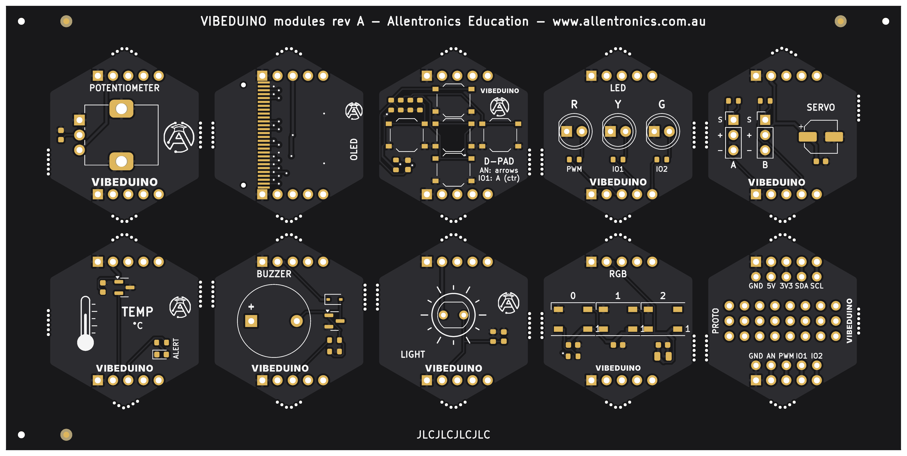

# VIBEDUINO module panel — JLCPCB production files

All ten hex modules on one **149.3 × 74.2 mm** panel, ready to upload to JLCPCB for PCB
fabrication and assembly. It is generated from the module boards in `../kicad/modules` by
`../generator/panel.py`; don't edit it by hand.



| Row | Modules (left → right) |
|---|---|
| Top | POT · OLED · D-PAD · LED · SERVO |
| Bottom | TEMP · BUZZER · LIGHT · RGB · PROTO |

[Bottom view](previews/vibeduino-modules-panel-bottom.png)

## Files

| File | Upload to JLCPCB as |
|---|---|
| `fab/vibeduino-modules-panel-gerbers.zip` | **Gerber file** (copper, mask, silk, paste, outline, PTH/NPTH drill) |
| `fab/vibeduino-modules-panel-bom-jlcpcb.csv` | **BOM** (with LCSC part numbers) |
| `fab/vibeduino-modules-panel-cpl-jlcpcb.csv` | **CPL / pick-and-place** (JLCPCB rotation offsets applied) |
| `fab/vibeduino-modules-panel-bom.csv` | Full BOM for your records: manufacturer, MPN, LCSC, side, process |
| `kicad/vibeduino-modules-panel.kicad_pcb` | The panel in KiCad (DRC: 0 errors, 0 unconnected) |

Designators are suffixed with the module name (`R1_DPAD`, `C3_OLED`, …) so every part on the
panel is unique.

## What's on the panel

* **5 mm frame** around the boards with a 2 mm milled gap. JLCPCB needs at least 5 mm rails for
  assembly.
* **Mouse-bite tabs**, 3 mm wide, with 0.5 mm holes at 0.8 mm pitch. Each tab position is chosen
  automatically so every mouse-bite hole edge stays at least 0.3 mm from copper (KiCad's
  hole-clearance rule is 0.25 mm). The edge between OLED and D-PAD has no tab because copper
  runs along it; both boards are still held by three tabs.
* **Fiducials**: three on each side (1 mm copper, 2 mm mask opening).
* **Tooling holes**: three 1.152 mm NPTH holes (JLCPCB's standard).
* **`JLCJLCJLCJLC`** on the bottom rail, so JLCPCB prints its order number there and not on a
  module.
* Panel text: *VIBEDUINO modules rev A – Allentronics Education – www.allentronics.com.au*.

## JLCPCB order settings

**PCB**

| Setting | Value |
|---|---|
| Base material / layers | FR-4, 2 layers |
| Dimensions | 149.3 × 74.2 mm (read from the Gerbers) |
| Delivery format | **Panel by Customer** (the frame, tabs, fiducials and tooling holes are already in the design) |
| Different designs | **10** (the panel holds ten different boards) |
| PCB thickness | 1.6 mm |
| Surface finish | **ENIG** recommended (flat pads for the 0.65 mm-pitch OLED FPC); lead-free HASL works for the rest |
| Mask / silk | Black / white (any colour works) |
| Via covering | **Tented** |
| Mark on PCB | **Specify a location** (the `JLCJLCJLCJLC` text) |
| Min track / hole | 0.15 mm / 0.3 mm — standard process |

**Assembly (PCBA)**

| Setting | Value |
|---|---|
| Assembly side | **Both sides.** The OLED module's ten passives are on its underside, so this needs JLCPCB's *Standard* PCBA. |
| Tooling holes | Added by customer |
| Confirm parts placement | **Yes.** Check every polarised part in the placement preview (SOT-23, WS2812B, diodes, LEDs, electrolytic). |

* **Through-hole parts** (pin headers, 5 mm LEDs, pot, buzzer, LDR) are in the BOM and CPL. JLCPCB
  can fit them, or you can untick those lines and solder them by hand. Every module's bus
  headers J1/J2 go on the **underside**, pins down. They appear as `Bottom` in the CPL.
* **No verified LCSC number**: 5 mm red and green LEDs, and the passive buzzer. Pick a part that
  matches the BOM description in JLCPCB's library, or hand-fit them.
* **The OLED glass is not in the JLCPCB files.** Solder its FPC by hand or hot-bar after
  assembly (see the main README's open items).
* LCSC numbers were checked against the LCSC/JLCPCB listings in October 2026. Re-check stock
  when you order.

## After delivery

Snap the modules out at the mouse bites and **sand the nubs flush**. On the shield,
neighbouring modules sit only 1 mm apart.

## Regenerating

```bash
pip install "kikit==1.6.0"   # KiKit 1.8 expects KiCad 9's layer numbering; 1.6 works with KiCad 7
python3 generator/panel.py   # run after build.py / release.py / step3d.py
```
