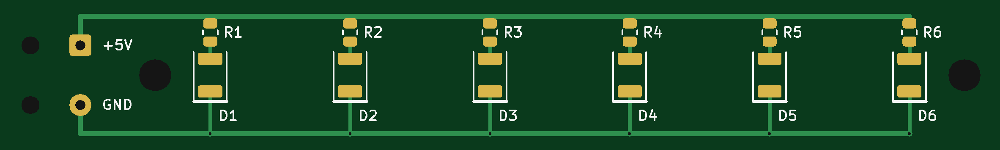
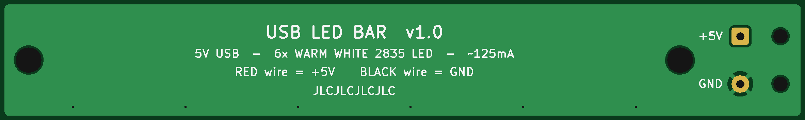

# USB LED Bar

A 100 × 15 mm light bar with **6 warm-white 2835 LEDs**, the same LED package used on LED strips.
It runs from **5 V on a cut USB cable** soldered straight to the board. JLCPCB fabricates it and
assembles the SMD parts. You only solder the two cable wires.

| | |
|---|---|
| Size | 100 × 15 mm, 1 mm corner radius, 2 × M3 mounting holes (81 mm apart) |
| PCB | 2 layers, 1.6 mm FR-4, 1 oz copper, GND pour on the bottom |
| LEDs | 6 × XINGLIGHT **XL-2835WWC-02**, warm white 2800–3000 K, SMD2835 (LCSC [C2843875](https://www.lcsc.com/product-detail/C2843875.html)) |
| Resistors | 6 × UNI-ROYAL **0805W8F1000T5E**, 100 Ω 1 % 0805 (LCSC [C17408](https://jlcpcb.com/partdetail/0805W8F1000T5E/C17408), JLCPCB *Basic* part) |
| Supply | 5 V from USB, about **20 mA per LED, about 125 mA in total** (fine for any USB port or phone charger) |

Schematic: [docs/usb-led-bar-schematic.pdf](docs/usb-led-bar-schematic.pdf)

## Files

| Path | What it is |
|---|---|
| `jlcpcb/usb-led-bar_gerbers.zip` | Gerbers + Excellon drill files. **Upload this on the PCB order page.** |
| `jlcpcb/usb-led-bar_bom.csv` | Bill of materials in JLCPCB format (Comment, Designator, Footprint, LCSC Part #) |
| `jlcpcb/usb-led-bar_cpl.csv` | Pick-and-place / centroid file in JLCPCB format (Designator, Mid X, Mid Y, Layer, Rotation) |
| `usb-led-bar.kicad_pro/_sch/_pcb` | KiCad project, schematic and board (made with KiCad 7, opens in KiCad 8/9) |
| `usb-led-bar.pretty/` | Project footprints: the 2835 LED, the USB wire pads, and an 0805 resistor (KiCad's stock one with silkscreen widened to 0.16 mm) |
| `scripts/export_jlcpcb.py` | Rebuilds everything in `jlcpcb/` from the KiCad files (`python3 scripts/export_jlcpcb.py`, needs `kicad-cli` from KiCad 7+) |

## Ordering from JLCPCB

1. On jlcpcb.com, click **Order now** and upload `jlcpcb/usb-led-bar_gerbers.zip`.
   It should detect **2 layers, 100 × 15 mm**.
2. PCB options. The defaults are fine: 1.6 mm, HASL (lead-free if you prefer), 1 oz, any colour.
   *White solder mask reflects more light, which suits a light bar.*
   For **Mark on PCB / Remove Order Number**, choose *Specify a location*. The board has a
   `JLCJLCJLCJLC` marker on the back, so the order number goes there instead of on the front.
3. Turn on **PCB Assembly**: *Economic*, **Top side**, tooling holes *Added by JLCPCB*.
4. Upload `jlcpcb/usb-led-bar_bom.csv` (BOM) and `jlcpcb/usb-led-bar_cpl.csv` (CPL).
   Both lines should match automatically: D1–D6 → C2843875 and R1–R6 → C17408.
   J1 (the cable pads) and the mounting holes have no parts, so they are not in the BOM.
5. **Check the LED polarity in the placement preview.** On every LED, the **cathode (–) must face the
   bottom edge**, toward the GND track. That end is marked by the **thick bar** on the silkscreen.
   If JLCPCB's part model shows the cathode at the top, rotate D1–D6 by 180° in the preview tool.
   The footprint is symmetric (see below), so the LED fits either way round. Only polarity matters.
6. Check the parts are in stock when you order. The LED is an *Extended* part, so expect a one-off
   extended-part fee (about US$3). The resistor is a *Basic* part with no fee.

## Attaching the USB cable

Use any USB-A (or USB-C) cable you can sacrifice. Cut off the far end and strip the jacket back about 3 cm.

* **Red → +5V**, **Black → GND**. Cut the green and white data wires short. Some cheap cables use
  other colours, so check with a multimeter: +5 V shows between the two power wires when it is plugged in.
* Strain relief: push each wire **down through its large hole** at the board edge, then **back up
  through its solder pad** from underneath, and solder on top. The loop takes the pull off the joint.
* If the wires are swapped, the LEDs just stay dark. Unplug it and swap the wires.

## Design notes

**Circuit.** Each LED has its own 100 Ω resistor and the six branches run in parallel off the
5 V rail. That keeps the brightness even even when individual LEDs have slightly different forward voltages.

| | Value |
|---|---|
| LED forward voltage (≈20 mA) | ≈2.9 V (spec 2.9–3.3 V) |
| LED current | (5.0 − 2.9) V / 100 Ω ≈ **21 mA** (≈23 mA at USB's 5.25 V maximum) |
| Resistor dissipation | ≈44 mW each (0805 rating 125 mW) |
| Total current | ≈125 mA |

About 20 mA is what 2835 LEDs typically get on 12 V LED strips. It is a comfortable fraction of the
60 mA these 0.2 W parts are usually rated for, so the LEDs run cool and last a long time. *(LCSC's
parameter table for C2843875 lists some ratings that don't agree with each other. Check the datasheet
on the part page before you raise the current.)*

**Brightness / colour changes.** The resistor value sets the current, about (5 − Vf) / R:

| R | Warm white (Vf ≈ 2.9 V) | Orange 2835 (Vf ≈ 2.0 V) |
|---|---|---|
| 68 Ω | ≈31 mA (brighter) | ≈44 mA, too much heat for an 0805 resistor |
| 100 Ω (as built) | ≈21 mA | ≈30 mA |
| 150 Ω | ≈14 mA (dimmer) | ≈20 mA |

To change it, edit the resistor value and its `LCSC` field in the schematic, then update the PCB
from the schematic and re-run the export script. You can also just edit the BOM line before uploading.
To get orange instead, use any orange/amber SMD2835 LED with **150 Ω** resistors.

**Polarity-tolerant 2835 footprint.** On 2835 LEDs, some manufacturers make the large pad the anode
and others make it the cathode. `LED_2835_PolarityTolerant` uses two equal pads whose inner edges are
2.1 mm apart. Whichever end the LED's large pad is on, it lands on one board pad only, and the small pad
lands on the other. So any 2835 LED fits, and polarity is set only by rotation (the silkscreen bar marks
the cathode). Pad 1 = cathode, pad 2 = anode. The trade-off is that only the outer part of the large
thermal pad gets soldered. That is irrelevant at about 60 mW per LED.

**Manufacturing rules.** Everything sits well inside JLCPCB's standard 2-layer capabilities, with no
extra-cost options:

| Rule | This board | JLCPCB standard minimum |
|---|---|---|
| Track width | 0.4–0.5 mm | 0.127 mm |
| Clearance | ≥ 0.2 mm | 0.127 mm |
| Via drill / pad | 0.3 / 0.6 mm | 0.3 mm drill |
| Copper to board edge | ≥ 0.5 mm (GND pour), ≥ 1.3 mm (tracks) | 0.3 mm |
| Silkscreen | text 1.0–1.5 mm high, all lines ≥ 0.16 mm | text 1.0 mm, lines 0.153 mm |

KiCad DRC reports 0 violations and 0 unconnected pads. The rules above are saved in the project's
board setup.

Gerber settings follow JLCPCB's KiCad guide: Protel file extensions, *subtract soldermask from
silkscreen*, no X2 / netlist attributes, drill / place origin at the board's bottom-left corner.
Drill files are Excellon, mm, decimal format, with plated and non-plated holes in separate files.
The CPL coordinates use the same origin (0, 0 = bottom-left corner of the board).
