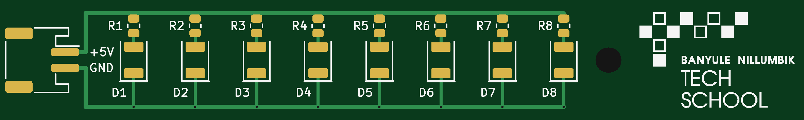
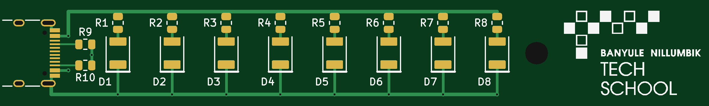
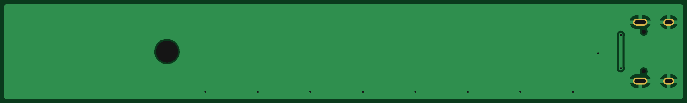
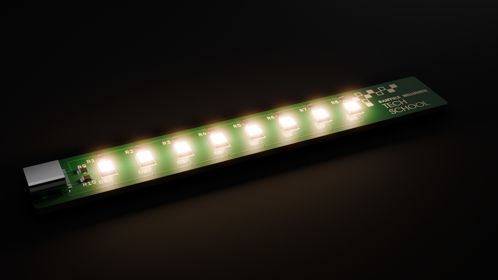
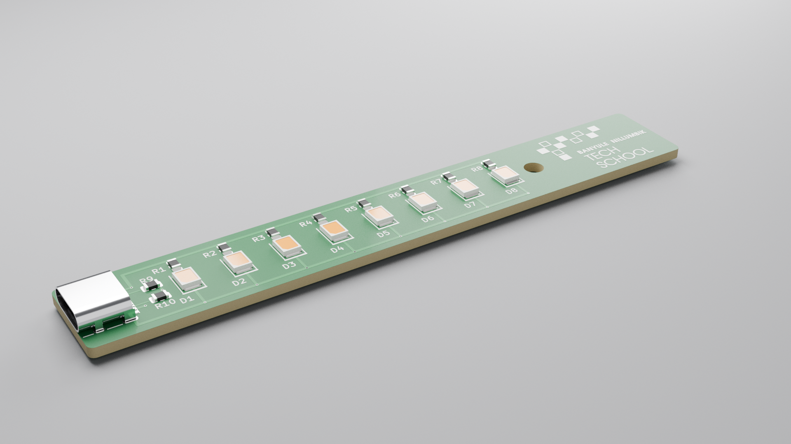
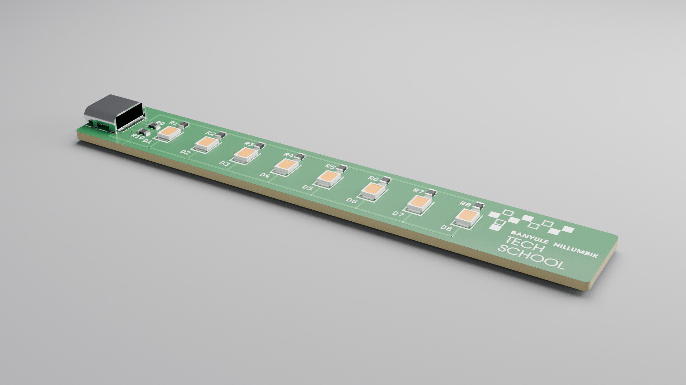
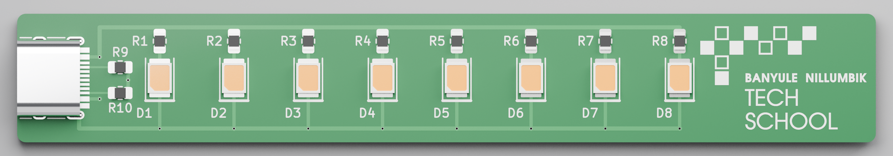
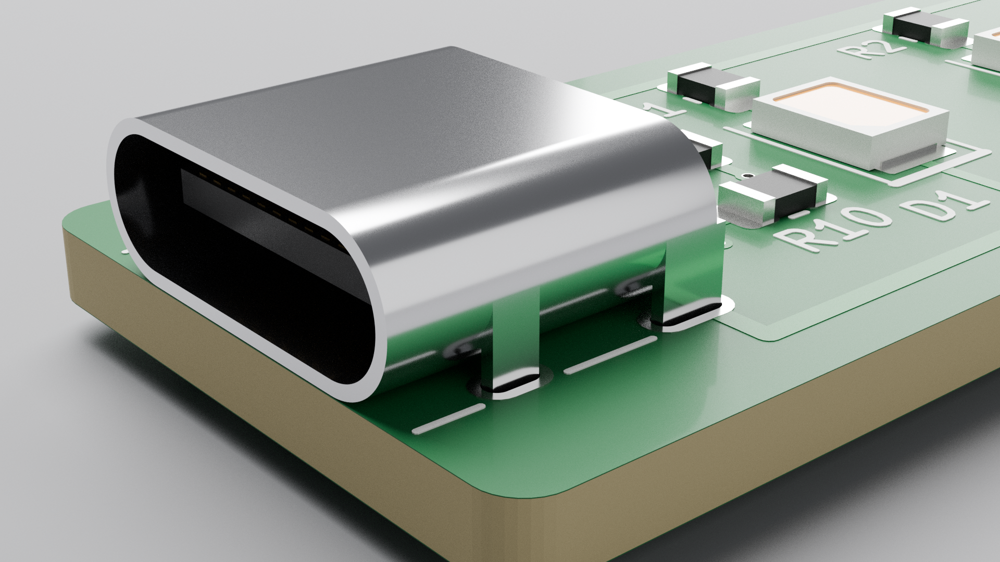
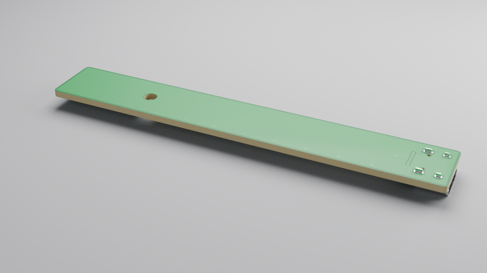

# USB LED Bar

A 100 × 15 mm light bar with **8 warm-white 2835 LEDs**, the same LED package used on LED strips.
It runs from 5 V USB and has the **Banyule Nillumbik Tech School logo** on the front at the right-hand end.
JLCPCB fabricates it and assembles every part. There is nothing to solder.

It comes in two variants. They share the same LED layout and differ only in the power input:

| | **JST** ([`jst/`](jst/)) | **USB-C** ([`usb-c/`](usb-c/)) |
|---|---|---|
| Power input | Right-angle **JST PH 2.0 mm** 2-pin socket, so the cable unplugs | On-board **USB-C** socket |
| Connector | JST S2B-PH-SM4-TB(LF)(SN), LCSC [C295747](https://jlcpcb.com/partdetail/Jst-S2B_PH_SM4_TB_LF_SN/C295747) | HRO TYPE-C-31-M-12, LCSC [C165948](https://jlcpcb.com/partdetail/Korean_HropartsElec-TYPE_C_31_M12/C165948) |
| Extra parts | – | 2 × 5.1 kΩ CC pull-downs (R9, R10), LCSC [C27834](https://jlcpcb.com/partdetail/0805W8F5101T5E/C27834) |
| Cable | USB-A → JST PH, ideally with a switch (see [Cables](#cables-for-the-jst-variant)) | Any USB-C cable or charger, including USB-A → C and C → C |

**JST variant**

**USB-C variant**

| Both variants | |
|---|---|
| Board | 100 × 15 mm, 1 mm corner radius, 2 layers, 1.6 mm FR-4, 1 oz copper, GND pour on the bottom, blank underside (no silkscreen) |
| Mounting | One **M3** hole (3.2 mm) at the logo end, between the last LED and the logo |
| LEDs | 8 × XINGLIGHT **XL-2835WWC-02**, warm white 2800–3000 K, SMD2835 (LCSC [C2843875](https://www.lcsc.com/product-detail/C2843875.html)) |
| LED resistors | 8 × UNI-ROYAL **0805W8F1000T5E**, 100 Ω 1 % 0805 (LCSC [C17408](https://jlcpcb.com/partdetail/0805W8F1000T5E/C17408), JLCPCB *Basic* part) |
| Current | about 21 mA per LED, **about 170 mA in total**, well within any USB port or phone charger |

Schematics: [jst/docs/usb-led-bar-jst-schematic.pdf](jst/docs/usb-led-bar-jst-schematic.pdf),
[usb-c/docs/usb-led-bar-usbc-schematic.pdf](usb-c/docs/usb-led-bar-usbc-schematic.pdf)

## 3D model and renders (USB-C variant)

**STEP CAD model:** [`usb-c/3d/usb-led-bar-usbc-step.zip`](usb-c/3d/usb-led-bar-usbc-step.zip).
Unzip it to get `usb-led-bar-usbc.step` (about 21 MB), which opens in Fusion 360, SolidWorks, Onshape,
FreeCAD, KiCad and similar. It is a coloured assembly with the board origin at the bottom-left corner,
the board's underside at Z = 0 and its top at Z = 1.6 mm. It contains:

* the FR-4 core, green solder mask, copper visible through the mask, tinned pads and plated holes;
* the white silkscreen (logo and part labels) on the top; the underside has none;
* the M3 mounting hole;
* every part: D1–D8 (2835 LEDs), R1–R10 (0805 resistors) and J1 (USB-C socket).

Overall size is 100 × 15 × 5.7 mm. The socket is the tallest part at 3.3 mm above the board, and its
shell tabs poke 0.8 mm through the underside.

The LED and USB-C models are my own simplified versions built from the datasheet outline dimensions
(`usb-led-bar.3dshapes/`), because the Debian KiCad package I worked from doesn't include those two
models. The outlines are accurate enough for enclosure design. The footprints point KiCad's 3D viewer
at the same files.

## Files

| Path | What it is |
|---|---|
| `jst/jlcpcb/`, `usb-c/jlcpcb/` | **What you upload to JLCPCB**, one set per variant: `*_gerbers.zip` (Gerbers + drill files), `*_bom.csv` (BOM) and `*_cpl.csv` (pick-and-place) |
| `jst/usb-led-bar-jst.kicad_*`, `usb-c/usb-led-bar-usbc.kicad_*` | KiCad project, schematic and board for each variant (made with KiCad 7, opens in KiCad 8/9) |
| `usb-led-bar.pretty/` | Shared footprints: the 2835 LED, the logo, and stock 0805 / JST PH / USB-C footprints with silkscreen widened to JLCPCB's minimum |
| `scripts/export_jlcpcb.py` | Rebuilds the `jlcpcb/` folders from the KiCad files: `python3 scripts/export_jlcpcb.py [jst] [usb-c]` (needs `kicad-cli` from KiCad 7+) |
| `usb-c/3d/`, `usb-c/docs/renders/` | Coloured STEP model (zipped) and photo-style renders of the USB-C variant |
| `usb-led-bar.3dshapes/` | 3D models of the 2835 LED and the HRO USB-C socket, used by the footprints and the STEP |
| `scripts/make_3d.py` | Rebuilds the STEP (and a `.glb` for rendering) from the KiCad board: `python3 scripts/make_3d.py usb-c` (needs KiCad's `pcbnew` Python module and `pip install cadquery`) |
| `scripts/render_blender.py` | Renders the `.glb` with Blender Cycles: `blender -b -P scripts/render_blender.py -- usb-c/3d/usb-led-bar-usbc.glb usb-c/docs/renders` |

## Ordering from JLCPCB

Pick one variant and use the three files from its `jlcpcb/` folder.

1. On jlcpcb.com, click **Order now** and upload `…_gerbers.zip`. It should detect **2 layers, 100 × 15 mm**.
2. PCB options. The defaults are fine: 1.6 mm, HASL (lead-free if you prefer), 1 oz.
   *White solder mask reflects more light, but the logo is white silkscreen and needs a dark mask:
   green, blue, black or purple.* The underside is deliberately blank, so under **Mark on PCB**
   choose **Remove Mark** (a small extra fee). Otherwise JLCPCB prints its order number wherever it
   finds room, possibly on the front.
3. Turn on **PCB Assembly**: *Economic*, **Top side**, tooling holes *Added by JLCPCB*.
4. Upload `…_bom.csv` and `…_cpl.csv`. Every line should match its LCSC part automatically.
5. **Check the placement preview:**
   * **LEDs D1–D8:** the cathode (–) must face the **bottom edge**, toward the GND track.
     That end is marked by the **thick bar** on the silkscreen. If JLCPCB's model shows them reversed,
     rotate the LEDs 180°. The footprint fits either way round (see *Design notes*), so only polarity matters.
   * **J1:** its pads should sit on the board pads and its opening should face the **left board edge**.
     Connector models are sometimes drawn differently, so rotate or nudge J1 in the tool if needed.
6. Check stock when you order. The LED and the connector are probably *Extended* parts, which adds a
   one-off fee of about US$3 each. The resistors are *Basic* parts with no fee.

## Cables for the JST variant

The board's socket is a **JST PH 2.0 mm, 2-pin** header: pin 1 = **+5V**, pin 2 = **GND**, marked on the
silkscreen. Any USB-A cable that ends in a **JST PH 2.0 mm 2-pin female plug** (housing PHR-2) fits it.
Make sure it is **PH (2.0 mm)**, not XH (2.5 mm), which looks similar but won't fit. Two ways to add a switch:

* **Plug-together, no tools:** a plain *USB-A → JST PH 2.0 2-pin* power cable, plus Adafruit's
  [JST PH 2-pin extension cable with on/off switch](https://www.adafruit.com/product/3064) between it and the board.
  Avoid "USB LiPo charger" leads that have a charging module or LED in the cable. Those put out about
  4.2 V, not 5 V, so the LEDs come out dim.
* **One quick splice:** a *USB-A cable with an inline on/off switch and bare wire ends*, for example
  [this 5 V USB switch cable](https://www.amazon.com/clp/B0DDL3W7G5), joined to a
  [JST PH 2-pin cable with a female connector](https://www.adafruit.com/product/3814).
  Join red to red and black to black, then solder and heat-shrink.

**Check polarity before you first plug it in.** Ready-made JST cables don't agree on which side is red.
With the USB end plugged in, use a multimeter on the plug's pins: **+5 V must be on the pin that lands
on "+5V"** on the board. If it is the wrong way round, the LEDs just stay dark. You can swap the two
crimp contacts in the plug by lifting the little plastic latches with a pin.

For the **USB-C variant**, any USB-C lead works. Inline-switch USB-A → USB-C cables are easy to find if
you want a switch on that one too.

## Design notes

**Circuit.** Each LED has its own 100 Ω resistor, and the eight branches run in parallel off the 5 V rail.
That keeps the brightness even even when individual LEDs have slightly different forward voltages.

| | Value |
|---|---|
| LED forward voltage (≈20 mA) | ≈2.9 V (spec 2.9–3.3 V) |
| LED current | (5.0 − 2.9) V / 100 Ω ≈ **21 mA** (≈23 mA at USB's 5.25 V maximum) |
| Resistor dissipation | ≈44 mW each (0805 rating 125 mW) |
| Total current | ≈170 mA |

About 20 mA is what 2835 LEDs typically get on 12 V LED strips. It is a comfortable fraction of the
60 mA these 0.2 W parts are usually rated for. *(LCSC's parameter table for C2843875 lists some ratings
that don't agree with each other. Check the datasheet on the part page before you raise the current.)*

**USB-C.** A USB-C charger or C-to-C cable only switches on 5 V once it sees a "sink" on the CC lines.
R9 and R10 provide that: 5.1 kΩ from **CC1** and from **CC2** to GND, one resistor per pin, as the USB-C
spec requires. Sharing one resistor between the pins doesn't work. D+, D− and SBU are unused.
All four VBUS pins and all four GND pins are connected, and the shell is tied to GND.

**Brightness / colour changes.** The resistor value sets the current, about (5 − Vf) / R:

| R | Warm white (Vf ≈ 2.9 V) | Orange 2835 (Vf ≈ 2.0 V) |
|---|---|---|
| 68 Ω | ≈31 mA (brighter, ≈250 mA total) | ≈44 mA, too much heat for an 0805 resistor |
| 100 Ω (as built) | ≈21 mA | ≈30 mA |
| 150 Ω | ≈14 mA (dimmer) | ≈20 mA |

**Polarity-tolerant 2835 footprint.** On 2835 LEDs, some manufacturers make the large pad the anode and
others make it the cathode. `LED_2835_PolarityTolerant` uses two equal pads whose inner edges are 2.1 mm
apart. Whichever end the LED's large pad is on, it lands on one board pad only, and the small pad lands on
the other. Polarity is then set only by rotation (the silkscreen bar marks the cathode).

**Logo.** I redrew it from the supplied image as one-colour silkscreen
(`Logo_Banyule_Nillumbik_Tech_School`, 19.3 × 12 mm). The pixel squares keep their layout, with the pale
(light teal and lavender) squares drawn as outlines so they still read as different tones. The lettering
uses URW Gothic, an Avant Garde-style face close to the original. "BANYULE NILLUMBIK" is 1.0 mm tall,
JLCPCB's minimum, and every stroke is at least 0.18 mm so it prints cleanly.
It is a *board-only* footprint, so updating the PCB from the schematic leaves it alone.

**Mounting.** There is one M3 hole (3.2 mm, non-plated) at the logo end, between D8 and the logo,
75.7 mm from the connector end of the board. Its 6.9 mm keep-out leaves room for an M3 pan or socket head (5.5–6 mm)
or a 7 mm washer, with no copper under it on the top. To make room, the LEDs are now 7.65 mm apart.
Hold the connector end down with a dab of double-sided foam tape or VHB, or let the cable support it.

**Manufacturing rules.** Everything sits well inside JLCPCB's standard 2-layer capabilities, with no
extra-cost options:

| Rule | This board | JLCPCB standard minimum |
|---|---|---|
| Track width | 0.25 mm (USB-C CC lines), 0.4–0.5 mm (power) | 0.127 mm |
| Clearance | ≥ 0.2 mm | 0.127 mm |
| Via drill / pad | 0.3 / 0.6 mm | 0.3 mm drill |
| Plated slots (USB-C shell) | 0.6 mm wide | 0.5 mm |
| Copper to board edge | ≥ 0.5 mm | 0.3 mm |
| Silkscreen | text ≥ 1.0 mm high, all lines ≥ 0.16 mm | text 1.0 mm, lines 0.153 mm |

For both variants, KiCad DRC reports 0 violations and 0 unconnected pads, and every pad's net matches
the schematic. The rules above are saved in each project's board setup.

Gerber settings follow JLCPCB's KiCad guide: Protel file extensions, *subtract soldermask from
silkscreen*, no X2 / netlist attributes, drill / place origin at the board's bottom-left corner.
Drill files are Excellon, mm, decimal format, with plated and non-plated holes in separate files.
The CPL coordinates use the same origin (0, 0 = bottom-left corner of the board).
